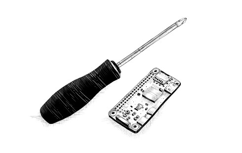
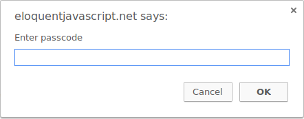
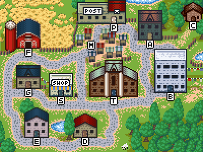

<!--
author:   Marijn Haverbeke

version:  1.0.0

language: en

narrator: US English Female

comment:  This is a book about JavaScript, programming, and the wonders of the digital. You can read it online here, or buy your own [paperback copy](https://nostarch.com/ejs3) (3rd edition).

@exec: <script>const rslt = eval(`@'input`); rslt === undefined ? "" : rslt</script>

-->

This is a book about JavaScript, programming, and the wonders of the digital. You can read it online here, or buy your own paperback copy (3rd edition).

Written by Marijn Haverbeke.

Licensed under a [Creative Commons attribution-noncommercial license](https://creativecommons.org/licenses/by-nc/3.0/). All code in this book may also be considered licensed under an MIT license.

Illustrations by various artists: Cover by [Péchane Sumi-e](http://www.pechane.com). Chapter illustrations by [Madalina Tantareanu](http://madalinatantareanu.com). Pixel art in Chapters 7 and 16 by Antonio Perdomo Pastor. Regular expression diagrams in Chapter 9 generated with [regexper.com](https://regexper.com) by Jeff Avallone. Game concept for Chapter 16 by [Thomas Palef](http://lessmilk.com).

A paper version of Eloquent JavaScript, including an additional chapter, is being brought out by [No Starch Press](http://www.nostarch.com/ejs3).

# Eloquent JavaScript

## Introduction

> We think we are creating the system for our own purposes. We believe we are making it in our own image... But the computer is not really like us. It is a projection of a very slim part of ourselves: that portion devoted to logic, order, rule, and clarity.
>
> -- Ellen Ullman, Close to the Machine: Technophilia and its Discontents



This is a book about instructing computers. Computers are about as common as screwdrivers today, but they are quite a bit more complex, and making them do what you want them to do isn’t always easy.

If the task you have for your computer is a common, well-understood one, such as showing you your email or acting like a calculator, you can open the appropriate application and get to work. But for unique or open-ended tasks, there often is no appropriate application.

That is where programming may come in. _Programming_ is the act of constructing a _program_—a set of precise instructions telling a computer what to do. Because computers are dumb, pedantic beasts, programming is fundamentally tedious and frustrating.

Fortunately, if you can get over that fact—and maybe even enjoy the rigor of thinking in terms that dumb machines can deal with—programming can be rewarding. It allows you to do things in seconds that would take _forever_ by hand. It is a way to make your computer tool do things that it couldn’t do before. On top of that, it makes for a wonderful game of puzzle solving and abstract thinking.

Most programming is done with programming languages. A _programming language_ is an artificially constructed language used to instruct computers. It is interesting that the most effective way we’ve found to communicate with a computer borrows so heavily from the way we communicate with each other. Like human languages, computer languages allow words and phrases to be combined in new ways, making it possible to express ever new concepts.

At one point, language-based interfaces, such as the BASIC and DOS prompts of the 1980s and 1990s, were the main method of interacting with computers. For routine computer use, these have largely been replaced with visual interfaces, which are easier to learn but offer less freedom. But if you know where to look, the languages are still there. One of them, _JavaScript_, is built into every modern web browser—and is thus available on almost every device.

This book will try to make you familiar enough with this language to do useful and amusing things with it.

### On programming

Besides explaining JavaScript, I will introduce the basic principles of programming. Programming, it turns out, is hard. The fundamental rules are simple and clear, but programs built on top of these rules tend to become complex enough to introduce their own rules and complexity. You’re building your own maze, in a way, and you can easily get lost in it.

There will be times when reading this book feels terribly frustrating. If you are new to programming, there will be a lot of new material to digest. Much of this material will then be _combined_ in ways that require you to make additional connections.

It is up to you to make the necessary effort. When you are struggling to follow the book, do not jump to any conclusions about your own capabilities. You are fine—you just need to keep at it. Take a break, reread some material, and make sure you read and understand the example programs and exercises. Learning is hard work, but everything you learn is yours and will make further learning easier.

> When action grows unprofitable, gather information; when information grows unprofitable, sleep.
>
> -- Ursula K. Le Guin, The Left Hand of Darkness

A program is many things. It is a piece of text typed by a programmer, it is the directing force that makes the computer do what it does, it is data in the computer’s memory, and, at the same time, it controls the actions performed on this memory. Analogies that try to compare programs to familiar objects tend to fall short. A superficially fitting one is to compare a program to a machine—lots of separate parts tend to be involved, and to make the whole thing tick, we have to consider the ways in which these parts interconnect and contribute to the operation of the whole.

A computer is a physical machine that acts as a host for these immaterial machines. Computers themselves can do only stupidly straightforward things. The reason they are so useful is that they do these things at an incredibly high speed. A program can ingeniously combine an enormous number of these simple actions to do very complicated things.

A program is a building of thought. It is costless to build, it is weightless, and it grows easily under our typing hands. But as a program grows, so does its complexity. The skill of programming is the skill of building programs that don’t confuse the programmer. The best programs are those that manage to do something interesting while still being easy to understand.

Some programmers believe that this complexity is best managed by using only a small set of well-understood techniques in their programs. They have composed strict rules (“best practices”) prescribing the form programs should have and carefully stay within their safe little zone.

This is not only boring, it is ineffective. New problems often require new solutions. The field of programming is young and still developing rapidly, and it is varied enough to have room for wildly different approaches. There are many terrible mistakes to make in program design, and you should go ahead and make them at least once so that you understand them. A sense of what a good program looks like is developed with practice, not learned from a list of rules.

### Why language matters

In the beginning, at the birth of computing, there were no programming languages. Programs looked something like this:

```
00110001 00000000 00000000
00110001 00000001 00000001
00110011 00000001 00000010
01010001 00001011 00000010
00100010 00000010 00001000
01000011 00000001 00000000
01000001 00000001 00000001
00010000 00000010 00000000
01100010 00000000 00000000
```

This is a program to add the numbers from 1 to 10 together and print the result: `1 + 2 + ... + 10 = 55`. It could run on a simple hypothetical machine. To program early computers, it was necessary to set large arrays of switches in the right position or punch holes in strips of cardboard and feed them to the computer. You can imagine how tedious and error-prone this procedure was. Even writing simple programs required much cleverness and discipline. Complex ones were nearly inconceivable.

Of course, manually entering these arcane patterns of bits (the ones and zeros) did give the programmer a profound sense of being a mighty wizard. And that has to be worth something in terms of job satisfaction.

Each line of the previous program contains a single instruction. It could be written in English like this:

1. Store the number 0 in memory location 0.
2. Store the number 1 in memory location 1.
3. Store the value of memory location 1 in memory location 2.
4. Subtract the number 11 from the value in memory location 2.
5. If the value in memory location 2 is the number 0, continue with instruction 9.
6. Add the value of memory location 1 to memory location 0.
7. Add the number 1 to the value of memory location 1.
8. Continue with instruction 3.
9. Output the value of memory location 0.

Although that is already more readable than the soup of bits, it is still rather obscure. Using names instead of numbers for the instructions and memory locations helps:

``` plaintext
 Set “total” to 0.
 Set “count” to 1.
[loop]
 Set “compare” to “count”.
 Subtract 11 from “compare”.
 If “compare” is zero, continue at [end].
 Add “count” to “total”.
 Add 1 to “count”.
 Continue at [loop].
[end]
 Output “total”.
```

Can you see how the program works at this point? The first two lines give two memory locations their starting values: `total` will be used to build up the result of the computation, and `count` will keep track of the number that we are currently looking at. The lines using `compare` are probably the most confusing ones. The program wants to see whether `count` is equal to 11 to decide whether it can stop running. Because our hypothetical machine is rather primitive, it can only test whether a number is zero and make a decision based on that. It therefore uses the memory location labeled `compare` to compute the value of `count - 11` and makes a decision based on that value. The next two lines add the value of `count` to the result and increment `count` by 1 every time the program decides that `count` is not 11 yet.

Here is the same program in JavaScript:

``` javascript
let total = 0, count = 1;
while (count <= 10) {
  total += count;
  count += 1;
}
console.log(total);
// → 55
```
@exec

This version gives us a few more improvements. Most importantly, there is no need to specify the way we want the program to jump back and forth anymore—the `while` construct takes care of that. It continues executing the block (wrapped in braces) below it as long as the condition it was given holds. That condition is `count <= 10`, which means “the count is less than or equal to 10”. We no longer have to create a temporary value and compare that to zero, which was just an uninteresting detail. Part of the power of programming languages is that they can take care of uninteresting details for us.

At the end of the program, after the `while` construct has finished, the `console.log` operation is used to write out the result.

Finally, here is what the program could look like if we happened to have the convenient operations `range` and `sum` available, which respectively create a collection of numbers within a range and compute the sum of a collection of numbers:

``` javascript
console.log(sum(range(1, 10)));
// → 55
```
<script>

function range(start, end) {
  let array = [];
  for (let i = start; i <= end; i++) {
    array.push(i);
  }
  return array;
}

function sum(array) {
  let total = 0;
  for (let value of array) {
    total += value;
  }
  return total;
}

const rslt = eval(`@'input`);

if (rslt === undefined) {
  ""
} else {
  rslt
}
</script>

The moral of this story is that the same program can be expressed in both long and short, unreadable and readable ways. The first version of the program was extremely obscure, whereas this last one is almost English: `log` the `sum` of the `range` of numbers from 1 to 10. (We will see in [later chapters](04_data.html) how to define operations like `sum` and `range`.)

A good programming language helps the programmer by allowing them to talk about the actions that the computer has to perform on a higher level. It helps omit details, provides convenient building blocks (such as `while` and `console.log`), allows you to define your own building blocks (such as `sum` and `range`), and makes those blocks easy to compose.

### What is JavaScript?

JavaScript was introduced in 1995 as a way to add programs to web pages in the Netscape Navigator browser. The language has since been adopted by all other major graphical web browsers. It has made modern web applications possible—that is, applications with which you can interact directly without doing a page reload for every action. JavaScript is also used in more traditional websites to provide various forms of interactivity and cleverness.

It is important to note that JavaScript has almost nothing to do with the programming language named Java. The similar name was inspired by marketing considerations rather than good judgment. When JavaScript was being introduced, the Java language was being heavily marketed and was gaining popularity. Someone thought it was a good idea to try to ride along on this success. Now we are stuck with the name.

After its adoption outside of Netscape, a standard document was written to describe the way the JavaScript language should work so that the various pieces of software that claimed to support JavaScript could make sure they actually provided the same language. This is called the ECMAScript standard, after the Ecma International organization that conducted the standardization. In practice, the terms ECMAScript and JavaScript can be used interchangeably—they are two names for the same language.

There are those who will say _terrible_ things about JavaScript. Many of these things are true. When I was required to write something in JavaScript for the first time, I quickly came to despise it. It would accept almost anything I typed but interpret it in a way that was completely different from what I meant. This had a lot to do with the fact that I did not have a clue what I was doing, of course, but there is a real issue here: JavaScript is ridiculously liberal in what it allows. The idea behind this design was that it would make programming in JavaScript easier for beginners. In actuality, it mostly makes finding problems in your programs harder because the system will not point them out to you.

This flexibility also has its advantages, though. It leaves room for techniques that are impossible in more rigid languages and makes for a pleasant, informal style of programming. After learning the language properly and working with it for a while, I have come to actually _like_ JavaScript.

There have been several versions of JavaScript. ECMAScript version 3 was the widely supported version during JavaScript’s ascent to dominance, roughly between 2000 and 2010. During this time, work was underway on an ambitious version 4, which planned a number of radical improvements and extensions to the language. Changing a living, widely used language in such a radical way turned out to be politically difficult, and work on version 4 was abandoned in 2008. A much less ambitious version 5, which made only some uncontroversial improvements, came out in 2009. In 2015, version 6 came out, a major update that included some of the ideas planned for version 4. Since then we’ve had new, small updates every year.

The fact that JavaScript is evolving means that browsers have to constantly keep up. If you’re using an older browser, it may not support every feature. The language designers are careful to not make any changes that could break existing programs, so new browsers can still run old programs. In this book, I’m using the 2023 version of JavaScript.

Web browsers are not the only platforms on which JavaScript is used. Some databases, such as MongoDB and CouchDB, use JavaScript as their scripting and query language. Several platforms for desktop and server programming, most notably the Node.js project (the subject of [Chapter 20](20_node.html)), provide an environment for programming JavaScript outside of the browser.

### Code, and what to do with it

_Code_ is the text that makes up programs. Most chapters in this book contain quite a lot of code. I believe reading code and writing code are indispensable parts of learning to program. Try to not just glance over the examples—read them attentively and understand them. This may be slow and confusing at first, but I promise that you’ll quickly get the hang of it. The same goes for the exercises. Don’t assume you understand them until you’ve actually written a working solution.

I recommend you try your solutions to exercises in an actual JavaScript interpreter. That way, you’ll get immediate feedback on whether what you are doing is working, and, I hope, you’ll be tempted to experiment and go beyond the exercises.

When reading this book in your browser, you can edit (and run) all example programs by clicking them.

Running the programs defined in this book outside of the book’s website requires some care. Many examples stand on their own and should work in any JavaScript environment. But code in later chapters is often written for a specific environment (the browser or Node.js) and can run only there. In addition, many chapters define bigger programs, and the pieces of code that appear in them depend on each other or on external files. The [sandbox](https://eloquentjavascript.net/code) on the website provides links to ZIP files containing all the scripts and data files necessary to run the code for a given chapter.

### Overview of this book

This book contains roughly three parts. The first 12 chapters discuss the JavaScript language. The next seven chapters are about web browsers and the way JavaScript is used to program them. Finally, two chapters are devoted to Node.js, another environment to program JavaScript in. There are five _project chapters_ in the book that describe larger example programs to give you a taste of actual programming.

The language part of the book starts with four chapters that introduce the basic structure of the JavaScript language. They discuss [control structures](02_program_structure.html) (such as the `while` word you saw in this introduction), [functions](03_functions.html) (writing your own building blocks), and [data structures](04_data.html). After these, you will be able to write basic programs. Next, Chapters [5](05_higher_order.html) and [6](06_object.html) introduce techniques to use functions and objects to write more _abstract_ code and keep complexity under control.

After a [first project chapter](07_robot.html) that builds a crude delivery robot, the language part of the book continues with chapters on [error handling and bug fixing](08_error.html), [regular expressions](09_regexp.html) (an important tool for working with text), [modularity](10_modules.html) (another defense against complexity), and [asynchronous programming](11_async.html) (dealing with events that take time). The [second project chapter](12_language.html), where we implement a programming language, concludes the first part of the book.

The second part of the book, Chapters [13](13_browser.html) to [19](19_paint.html), describes the tools that browser JavaScript has access to. You’ll learn to display things on the screen (Chapters [14](14_dom.html) and [17](17_canvas.html)), respond to user input ([Chapter 15](15_event.html)), and communicate over the network ([Chapter 18](18_http.html)). There are again two project chapters in this part, building a [platform game](16_game.html) and a [pixel paint program](19_paint.html).

[Chapter 20](20_node.html) describes Node.js, and [Chapter 21](21_skillsharing.html) builds a small website using that tool.

### Typographic conventions

In this book, text written in a `monospaced` font will represent elements of programs. Sometimes these are self-sufficient fragments, and sometimes they just refer to part of a nearby program. Programs (of which you have already seen a few) are written as follows:

``` javascript
function factorial(n) {
  if (n == 0) {
    return 1;
  } else {
    return factorial(n - 1) * n;
  }
}

console.log(factorial(8));
// → 40320
```
@exec

Sometimes, to show the output that a program produces, the expected output is written after it, with two slashes and an arrow in front.

Good luck!

## Values, Types, and Operators

> Below the surface of the machine, the program moves. Without effort, it expands and contracts. In great harmony, electrons scatter and regroup. The forms on the monitor are but ripples on the water. The essence stays invisibly below.
>
> -- Master Yuan-Ma, The Book of Programming


In the computer’s world, there is only data. You can read data, modify data, create new data—but that which isn’t data cannot be mentioned. All this data is stored as long sequences of bits and is thus fundamentally alike.

_Bits_ are any kind of two-valued things, usually described as zeros and ones. Inside the computer, they take forms such as a high or low electrical charge, a strong or weak signal, or a shiny or dull spot on the surface of a CD. Any piece of discrete information can be reduced to a sequence of zeros and ones and thus represented in bits.

For example, we can express the number 13 in bits. This works the same way as a decimal number, but instead of 10 different digits, we have only 2, and the weight of each increases by a factor of 2 from right to left. Here are the bits that make up the number 13, with the weights of the digits shown below them:

```
   0   0   0   0   1   1   0   1
 128  64  32  16   8   4   2   1
```

That’s the binary number 00001101. Its non-zero digits stand for 8, 4, and 1, and add up to 13.

### Values

Imagine a sea of bits—an ocean of them. A typical modern computer has more than 100 billion bits in its volatile data storage (working memory). Nonvolatile storage (the hard disk or equivalent) tends to have yet a few orders of magnitude more.

To be able to work with such quantities of bits without getting lost, we separate them into chunks that represent pieces of information. In a JavaScript environment, those chunks are called _values_. Though all values are made of bits, they play different roles. Every value has a type that determines its role. Some values are numbers, some values are pieces of text, some values are functions, and so on.

To create a value, you must merely invoke its name. This is convenient. You don’t have to gather building material for your values or pay for them. You just call for one, and _whoosh_, you have it. Of course, values are not really created from thin air. Each one has to be stored somewhere, and if you want to use a gigantic number of them at the same time, you might run out of computer memory. Fortunately, this is a problem only if you need them all simultaneously. As soon as you no longer use a value, it will dissipate, leaving behind its bits to be recycled as building material for the next generation of values.

The remainder of this chapter introduces the atomic elements of JavaScript programs, that is, the simple value types and the operators that can act on such values.

### Numbers

Values of the _number_ type are, unsurprisingly, numeric values. In a JavaScript program, they are written as follows:

``` javascript
13
```
@exec

Using that in a program will cause the bit pattern for the number 13 to come into existence inside the computer’s memory.

JavaScript uses a fixed number of bits, 64 of them, to store a single number value. There are only so many patterns you can make with 64 bits, which limits the number of different numbers that can be represented. With _N_ decimal digits, you can represent 10N numbers. Similarly, given 64 binary digits, you can represent 264 different numbers, which is about 18 quintillion (an 18 with 18 zeros after it). That’s a lot.

Computer memory used to be much smaller, and people tended to use groups of 8 or 16 bits to represent their numbers. It was easy to accidentally _overflow_ such small numbers—to end up with a number that did not fit into the given number of bits. Today, even computers that fit in your pocket have plenty of memory, so you are free to use 64-bit chunks, and you need to worry about overflow only when dealing with truly astronomical numbers.

Not all whole numbers less than 18 quintillion fit in a JavaScript number, though. Those bits also store negative numbers, so one bit indicates the sign of the number. A bigger issue is representing nonwhole numbers. To do this, some of the bits are used to store the position of the decimal point. The actual maximum whole number that can be stored is more in the range of 9 quadrillion (15 zeros)—which is still pleasantly huge.

Fractional numbers are written using a dot:

``` javascript
9.81
```
@exec

For very big or very small numbers, you may also use scientific notation by adding an _e_ (for _exponent_), followed by the exponent of the number:

``` javascript
2.998e8
```
@exec

That’s 2.998 × 108 = 299,800,000.

Calculations with whole numbers (also called _integers_) that are smaller than the aforementioned 9 quadrillion are guaranteed to always be precise. Unfortunately, calculations with fractional numbers are generally not. Just as π (pi) cannot be precisely expressed by a finite number of decimal digits, many numbers lose some precision when only 64 bits are available to store them. This is a shame, but it causes practical problems only in specific situations. The important thing is to be aware of it and treat fractional digital numbers as approximations, not as precise values.

#### Arithmetic

The main thing to do with numbers is arithmetic. Arithmetic operations such as addition or multiplication take two number values and produce a new number from them. Here is what they look like in JavaScript:

``` javascript
100 + 4 * 11
```
@exec

The `+` and `*` symbols are called _operators_. The first stands for addition and the second stands for multiplication. Putting an operator between two values will apply it to those values and produce a new value.

Does this example mean “Add 4 and 100, and multiply the result by 11”, or is the multiplication done before the adding? As you might have guessed, the multiplication happens first. As in mathematics, you can change this by wrapping the addition in parentheses:

``` javascript
(100 + 4) * 11
```
@exec

For subtraction, there is the `-` operator. Division can be done with the `/` operator.

When operators appear together without parentheses, the order in which they are applied is determined by the _precedence_ of the operators. The example shows that multiplication comes before addition. The `/` operator has the same precedence as `*`. Likewise, `+` and `-` have the same precedence. When multiple operators with the same precedence appear next to each other, as in `1 - 2 + 1`, they are applied left to right: `(1 - 2) + 1`.

Don’t worry too much about these precedence rules. When in doubt, just add parentheses.

There is one more arithmetic operator, which you might not immediately recognize. The `%` symbol is used to represent the _remainder_ operation. `X % Y` is the remainder of dividing `X` by `Y`. For example, `314 % 100` produces `14`, and `144 % 12` gives `0`. The remainder operator’s precedence is the same as that of multiplication and division. You’ll also often see this operator referred to as _modulo_.

#### Special numbers

There are three special values in JavaScript that are considered numbers but don’t behave like normal numbers. The first two are `Infinity` and `-Infinity`, which represent the positive and negative infinities. `Infinity - 1` is still `Infinity`, and so on. Don’t put too much trust in infinity-based computation, though. It isn’t mathematically sound, and it will quickly lead to the next special number: `NaN`.

`NaN` stands for “not a number”, even though it _is_ a value of the number type. You’ll get this result when you, for example, try to calculate `0 / 0` (zero divided by zero), `Infinity - Infinity`, or any number of other numeric operations that don’t yield a meaningful result.

### Strings

The next basic data type is the _string_. Strings are used to represent text. They are written by enclosing their content in quotes.

``` javascript
`Down on the sea`

"Lie on the ocean"

'Float on the ocean'
```

You can use single quotes, double quotes, or backticks to mark strings, as long as the quotes at the start and the end of the string match.

You can put almost anything between quotes to have JavaScript make a string value out of it. But a few characters are more difficult. You can imagine how putting quotes between quotes might be hard, since they will look like the end of the string. _Newlines_ (the characters you get when you press enter) can be included only when the string is quoted with backticks (` \` `).

To make it possible to include such characters in a string, the following notation is used: a backslash (` \ `) inside quoted text indicates that the character after it has a special meaning. This is called _escaping_ the character. A quote that is preceded by a backslash will not end the string but be part of it. When an `n` character occurs after a backslash, it is interpreted as a newline. Similarly, a `t` after a backslash means a tab character. Take the following string:

``` javascript
"This is the first line\nAnd this is the second"
```
@exec

This is the actual text in that string:

``` @output
This is the first line
And this is the second
```

There are, of course, situations where you want a backslash in a string to be just a backslash, not a special code. If two backslashes follow each other, they will collapse together, and only one will be left in the resulting string value. This is how the string `“A newline character is written like "\n".”` can be expressed:

``` javascript
"A newline character is written like \"\\n\"."
```
@exec

Strings, too, have to be modeled as a series of bits to be able to exist inside the computer. The way JavaScript does this is based on the _Unicode_ standard. This standard assigns a number to virtually every character you would ever need, including characters from Greek, Arabic, Japanese, Armenian, and so on. If we have a number for every character, a string can be described by a sequence of numbers. And that’s what JavaScript does.

There’s a complication though: JavaScript’s representation uses 16 bits per string element, which can describe up to 2^16^ different characters. However, Unicode defines more characters than that—about twice as many, at this point. So some characters, such as many emoji, take up two “character positions” in JavaScript strings. We’ll come back to this in [Chapter 5](05_higher_order.html#code_units).

Strings cannot be divided, multiplied, or subtracted. The `+` operator _can_ be used on them, not to add, but to _concatenate_—to glue two strings together. The following line will produce the string `"concatenate"`:

``` javascript
"con" + "cat" + "e" + "nate"
```
@exec

When an operator is applied to the “wrong” type of value, JavaScript will quietly convert that value to the type it needs, using a set of rules that often aren’t what you want or expect. This is called _type coercion_. The `+` operator is supposed to add numbers. But when one of the arguments is not a number, it converts the other one into a string. Then it concatenates the two strings.

String values have a number of associated functions (_methods_) that can be used to perform other operations on them. I’ll say more about these in [Chapter 4](04_data.html#methods).

Strings written with single or double quotes behave very much the same—the only difference lies in which type of quote you need to escape inside of them. Backtick-quoted strings, usually called _template literals_, can do a few more tricks. Apart from being able to span lines, they can also embed other values.

``` javascript
`half of 100 is ${100 / 2}`
```
@exec

When you write something inside `${}` in a template literal, its result will be computed, converted to a string, and included at that position. This example produces “_half of 100 is 50_”.

### Unary operators

Not all operators are symbols. Some are written as words. One example is the `typeof` operator, which produces a string value naming the type of the value you give it.

``` javascript
console.log(typeof 4.5)
// → number
console.log(typeof "x")
// → string
```
@exec

We will use `console.log` in example code to indicate that we want to see the result of evaluating something. More about that in the [next chapter](02_program_structure.html).

The other operators shown so far in this chapter all operated on two values, but `typeof` takes only one. Operators that use two values are called _binary_ operators, while those that take one are called _unary_ operators. The minus operator can be used both as a binary operator and as a unary operator.

``` javascript
console.log(- (10 - 2))
// → -8
```
@exec

### Boolean values

It is often useful to have a value that distinguishes between only two possibilities, like “yes” and “no” or “on” and “off”. For this purpose, JavaScript has a _Boolean_ type, which has just two values, true and false, written as those words.

#### Comparison

Here is one way to produce Boolean values:

``` javascript
console.log(3 > 2)
// → true
console.log(3 < 2)
// → false
```
@exec

The `>` and `<` signs are the traditional symbols for “is greater than” and “is less than”, respectively. They are binary operators. Applying them results in a Boolean value that indicates whether they hold true in this case.

Strings can be compared in the same way:

``` javascript
console.log("Aardvark" < "Zoroaster")
// → true
```
@exec

The way strings are ordered is roughly alphabetic but not really what you’d expect to see in a dictionary: uppercase letters are always “less” than lowercase ones, so `"Z" < "a"`, and nonalphabetic characters (!, -, and so on) are also included in the ordering. When comparing strings, JavaScript goes over the characters from left to right, comparing the Unicode codes one by one.

Other similar operators are `>=` (greater than or equal to), `<=` (less than or equal to), `==` (equal to), and `!=` (not equal to).

``` javascript
console.log("Garnet" != "Ruby")
// → true
console.log("Pearl" == "Amethyst")
// → false
```
@exec

There is only one value in JavaScript that is not equal to itself, and that is `NaN` (“not a number”).

``` javascript
console.log(NaN == NaN)
// → false
```
@exec

`NaN` is supposed to denote the result of a nonsensical computation, and as such, it isn’t equal to the result of any _other_ nonsensical computations.

#### Logical operators

There are also some operations that can be applied to Boolean values themselves. JavaScript supports three logical operators: _and_, _or_, and _not_. These can be used to “reason” about Booleans.

The `&&` operator represents logical _and_. It is a binary operator, and its result is true only if both the values given to it are true.

``` javascript
console.log(true && false)
// → false
console.log(true && true)
// → true
```
@exec

The `||` operator denotes logical _or_. It produces true if either of the values given to it is true.

``` javascript
console.log(false || true)
// → true
console.log(false || false)
// → false
```
@exec

_Not_ is written as an exclamation mark (`!`). It is a unary operator that flips the value given to it—`!true` produces `false` and `!false` gives `true`.

When mixing these Boolean operators with arithmetic and other operators, it is not always obvious when parentheses are needed. In practice, you can usually get by with knowing that of the operators we have seen so far, `||` has the lowest precedence, then comes `&&`, then the comparison operators (`>`, `==`, and so on), and then the rest. This order has been chosen such that, in typical expressions like the following one, as few parentheses as possible are necessary:

``` javascript
1 + 1 == 2 && 10 * 10 > 50
```
@exec

The last logical operator we will look at is not unary, not binary, but _ternary_, operating on three values. It is written with a question mark and a colon, like this:

``` javascript
console.log(true ? 1 : 2);
// → 1
console.log(false ? 1 : 2);
// → 2
```
@exec

This one is called the _conditional_ operator (or sometimes just _the ternary operator_ since it is the only such operator in the language). The operator uses the value to the left of the question mark to decide which of the two other values to “pick”. If you write `a ? b : c`, the result will be `b` when `a` is true and `c` otherwise.

### Empty values

There are two special values, written `null` and `undefined`, that are used to denote the absence of a _meaningful_ value. They are themselves values, but they carry no information.

Many operations in the language that don’t produce a meaningful value yield `undefined` simply because they have to yield _some_ value.

The difference in meaning between `undefined` and `null` is an accident of JavaScript’s design, and it doesn’t matter most of the time. In cases where you actually have to concern yourself with these values, I recommend treating them as mostly interchangeable.

### Automatic type conversion

In the [Introduction](#introduction), I mentioned that JavaScript goes out of its way to accept almost any program you give it, even programs that do odd things. This is nicely demonstrated by the following expressions:

``` javascript
console.log(8 * null)
// → 0
console.log("5" - 1)
// → 4
console.log("5" + 1)
// → 51
console.log("five" * 2)
// → NaN
console.log(false == 0)
// → true
```
@exec

When an operator is applied to the “wrong” type of value, JavaScript will quietly convert that value to the type it needs, using a set of rules that often aren’t what you want or expect. This is called _type coercion_. The `null` in the first expression becomes `0` and the `"5"` in the second expression becomes `5` (from string to number). Yet in the third expression, `+` tries string concatenation before numeric addition, so the `1` is converted to `"1"` (from number to string).

When something that doesn’t map to a number in an obvious way (such as `"five"` or `undefined`) is converted to a number, you get the value `NaN`. Further arithmetic operations on `NaN` keep producing `NaN`, so if you find yourself getting one of those in an unexpected place, look for accidental type conversions.

When comparing values of the same type using the `==` operator, the outcome is easy to predict: you should get true when both values are the same, except in the case of `NaN`. But when the types differ, JavaScript uses a complicated and confusing set of rules to determine what to do. In most cases, it just tries to convert one of the values to the other value’s type. However, when `null` or `undefined` occurs on either side of the operator, it produces true only if both sides are one of `null` or `undefined`.

``` javascript
console.log(null == undefined);
// → true
console.log(null == 0);
// → false
```
@exec

That behavior is often useful. When you want to test whether a value has a real value instead of `null` or `undefined`, you can compare it to `null` with the `==` or `!=` operator.

What if you want to test whether something refers to the precise value `false`? Expressions like `0 == false` and `"" == false` are also true because of automatic type conversion. When you do _not_ want any type conversions to happen, there are two additional operators: `===` and `!==`. The first tests whether a value is _precisely_ equal to the other, and the second tests whether it is not precisely equal. Thus `"" === false` is false as expected.

I recommend using the three-character comparison operators defensively to prevent unexpected type conversions from tripping you up. But when you’re certain the types on both sides will be the same, there is no problem with using the shorter operators.

#### Short-circuiting of logical operators

The logical operators `&&` and `||` handle values of different types in a peculiar way. They will convert the value on their left side to Boolean type in order to decide what to do, but depending on the operator and the result of that conversion, they will return either the _original_ left-hand value or the right-hand value.

The `||` operator, for example, will return the value to its left when that value can be converted to true and will return the value on its right otherwise. This has the expected effect when the values are Boolean and does something analogous for values of other types.

``` javascript
console.log(null || "user")
// → user
console.log("Agnes" || "user")
// → Agnes
```
@exec

We can use this functionality as a way to fall back on a default value. If you have a value that might be empty, you can put `||` after it with a replacement value. If the initial value can be converted to false, you’ll get the replacement instead. The rules for converting strings and numbers to Boolean values state that `0`, `NaN`, and the empty string (`""`) count as `false`, while all the other values count as `true`. That means `0 || -1` produces `-1`, and `"" || "!?"` yields `"!?"`.

The `??` operator resembles `||`, but returns the value on the right only if the one on the left is null or undefined, not if it is some other value that can be converted to `false`. Often, this is preferable to the behavior of `||`.

``` javascript
console.log(0 || 100);
// → 100
console.log(0 ?? 100);
// → 0
console.log(null ?? 100);
// → 100
```
@exec

The `&&` operator works similarly but the other way around. When the value to its left is something that converts to false, it returns that value, and otherwise it returns the value on its right.

Another important property of these two operators is that the part to their right is evaluated only when necessary. In the case of `true || X`, no matter what `X` is—even if it’s a piece of program that does something _terrible_—the result will be true, and `X` is never evaluated. The same goes for `false && X`, which is false and will ignore `X`. This is called _short-circuit evaluation_.

The conditional operator works in a similar way. Of the second and third values, only the one that is selected is evaluated.

### Summary

We looked at four types of JavaScript values in this chapter: numbers, strings, Booleans, and undefined values. Such values are created by typing in their name (`true`, `null`) or value (`13`, `"abc"`).

You can combine and transform values with operators. We saw binary operators for arithmetic (`+`, `-`, `*`, `/`, and `%`), string concatenation (`+`), comparison (`==`, `!=`, `===`, `!==`, `<`, `>`, `<=`, `>=`), and logic (`&&`, `||`, `??`), as well as several unary operators (`-` to negate a number, `!` to negate logically, and `typeof` to find a value’s type) and a ternary operator (`?:`) to pick one of two values based on a third value.

This gives you enough information to use JavaScript as a pocket calculator but not much more. The [next chapter](02_program_structure.html) will start tying these expressions together into basic programs.

## Program Structure

> And my heart glows bright red under my filmy, translucent skin and they have to administer 10cc of JavaScript to get me to come back. (I respond well to toxins in the blood.) Man, that stuff will kick the peaches right out your gills!
>
> -- why, Why's (Poignant) Guide to Ruby


In this chapter, we will start to do things that can actually be called _programming_. We will expand our command of the JavaScript language beyond the nouns and sentence fragments we’ve seen so far to the point where we can express meaningful prose.

### Expressions and statements

In [Chapter 1](01_values.html), we made values and applied operators to them to get new values. Creating values like this is the main substance of any JavaScript program. But that substance has to be framed in a larger structure to be useful. That’s what we’ll cover in this chapter.

A fragment of code that produces a value is called an _expression_. Every value that is written literally (such as `22` or `"psychoanalysis"`) is an expression. An expression between parentheses is also an expression, as is a binary operator applied to two expressions or a unary operator applied to one.

This shows part of the beauty of a language-based interface. Expressions can contain other expressions in a way similar to how subsentences in human languages are nested—a subsentence can contain its own subsentences, and so on. This allows us to build expressions that describe arbitrarily complex computations.

If an expression corresponds to a sentence fragment, a JavaScript _statement_ corresponds to a full sentence. A program is a list of statements.

The simplest kind of statement is an expression with a semicolon after it. This is a program:

``` javascript
1;
```
@exec

---

``` javascript
!false;
```
@exec

It is a useless program, though. An expression can be content to just produce a value, which can then be used by the enclosing code. However, a statement stands on its own, so if it doesn’t affect the world, it’s useless. It may display something on the screen, as with `console.log`, or change the state of the machine in a way that will affect the statements that come after it. These changes are called _side effects_. The statements in the previous example just produce the values `1` and `true` and then immediately throw them away. This leaves no impression on the world at all. When you run this program, nothing observable happens.

In some cases, JavaScript allows you to omit the semicolon at the end of a statement. In other cases, it has to be there, or the next line will be treated as part of the same statement. The rules for when it can be safely omitted are somewhat complex and error-prone. So in this book, every statement that needs a semicolon will always get one. I recommend you do the same, at least until you’ve learned more about the subtleties of missing semicolons.

### Bindings

How does a program keep an internal state? How does it remember things? We have seen how to produce new values from old values, but this does not change the old values, and the new value must be used immediately or it will dissipate again. To catch and hold values, JavaScript provides a thing called a _binding_, or _variable_:

``` javascript
let caught = 5 * 5;
```
@exec

That gives us a second kind of statement. The special word (_keyword_) `let` indicates that this sentence is going to define a binding. It is followed by the name of the binding and, if we want to immediately give it a value, by an `=` operator and an expression.

The example creates a binding called `caught` and uses it to grab hold of the number that is produced by multiplying 5 by 5.

After a binding has been defined, its name can be used as an expression. The value of such an expression is the value the binding currently holds. Here’s an example:

``` javascript
let ten = 10;
console.log(ten * ten);
// → 100
```
@exec

When a binding points at a value, that does not mean it is tied to that value forever. The `=` operator can be used at any time on existing bindings to disconnect them from their current value and have them point to a new one:

When a binding points at a value, that does not mean it is tied to that value forever. The `=` operator can be used at any time on existing bindings to disconnect them from their current value and have them point to a new one:

``` javascript
let mood = "light";
console.log(mood);
// → light
mood = "dark";
console.log(mood);
// → dark
```
@exec

You should imagine bindings as tentacles rather than boxes. They do not _contain_ values; they _grasp_ them—two bindings can refer to the same value. A program can access only the values to which it still has a reference. When you need to remember something, you either grow a tentacle to hold on to it or reattach one of your existing tentacles to it.

Let’s look at another example. To remember the number of dollars that Luigi still owes you, you create a binding. When he pays back $35, you give this binding a new value:

``` javascript
let luigisDebt = 140;
luigisDebt = luigisDebt - 35;
console.log(luigisDebt);
// → 105
```
@exec

When you define a binding without giving it a value, the tentacle has nothing to grasp, so it ends in thin air. If you ask for the value of an empty binding, you’ll get the value `undefined`.

A single `let` statement may define multiple bindings. The definitions must be separated by commas:

``` javascript
let one = 1, two = 2;
console.log(one + two);
// → 3
```
@exec

The words `var` and `const` can also be used to create bindings, in a similar fashion to `let`:

``` javascript
var name = "Ayda";
const greeting = "Hello ";
console.log(greeting + name);
// → Hello Ayda
```
@exec

The first of these, `var` (short for “variable”), is the way bindings were declared in pre-2015 JavaScript, when `let` didn’t exist yet. I’ll get back to the precise way it differs from `let` in the [next chapter](03_functions.html). For now, remember that it mostly does the same thing, but we’ll rarely use it in this book because it behaves oddly in some situations.

The word `const` stands for _constant_. It defines a constant binding, which points at the same value for as long as it lives. This is useful for bindings that just give a name to a value so that you can easily refer to it later.

### Binding names

Binding names can be any sequence of one or more letters. Digits can be part of binding names—`catch22` is a valid name, for example—but the name must not start with a digit. A binding name may include dollar signs (`$`) or underscores (`_`) but no other punctuation or special characters.

Words with a special meaning, such as `let`, are _keywords_, and may not be used as binding names. There are also a number of words that are “reserved for use” in future versions of JavaScript, which also can’t be used as binding names. The full list of keywords and reserved words is rather long:

> break case catch class const continue debugger default
> delete do else enum export extends false finally for
> function if implements import interface in instanceof let
> new package private protected public return static super
> switch this throw true try typeof var void while with yield

Don’t worry about memorizing this list. When creating a binding produces an unexpected syntax error, check whether you’re trying to define a reserved word.

### The environment

The collection of bindings and their values that exist at a given time is called the _environment_. When a program starts up, this environment is not empty. It always contains bindings that are part of the language standard, and most of the time, it also has bindings that provide ways to interact with the surrounding system. For example, in a browser, there are functions to interact with the currently loaded website and to read mouse and keyboard input.

### Functions

A lot of the values provided in the default environment have the type _function_. A function is a piece of program wrapped in a value. Such values can be _applied_ in order to run the wrapped program. For example, in a browser environment, the binding `prompt` holds a function that shows a little dialog box asking for user input. It is used like this:

``` javascript
prompt("Enter passcode");
```
@exec



Executing a function is called _invoking_, _calling_, or _applying_ it. You can call a function by putting parentheses after an expression that produces a function value. Usually you’ll directly use the name of the binding that holds the function. The values between the parentheses are given to the program inside the function. In the example, the `prompt` function uses the string that we give it as the text to show in the dialog box. Values given to functions are called _arguments_. Different functions might need a different number or different types of arguments.

The `prompt` function isn’t used much in modern web programming, mostly because you have no control over the way the resulting dialog looks, but it can be helpful in toy programs and experiments.

### The `console.log` function

In the examples, I used `console.log` to output values. Most JavaScript systems (including all modern web browsers and Node.js) provide a `console.log` function that writes out its arguments to _some_ text output device. In browsers, the output lands in the JavaScript console. This part of the browser interface is hidden by default, but most browsers open it when you press F12 or, on a Mac, command\-option\-I. If that does not work, search through the menus for an item named Developer Tools or similar.

When running the examples (or your own code) on the pages of this book, `console.log` output will be shown after the example, instead of in the browser’s JavaScript console.

``` javascript
let x = 30;
console.log("the value of x is", x);
// → the value of x is 30
```
@exec

Though binding names cannot contain period characters, `console.log` does have one. This is because `console.log` isn’t a simple binding, but an expression that retrieves the `log` property from the value held by the `console` binding. We’ll find out exactly what this means in [Chapter 4](04_data.html#properties).

### Return values

Showing a dialog box or writing text to the screen is a _side effect_. Many functions are useful because of the side effects they produce. Functions may also produce values, in which case they don’t need to have a side effect to be useful. For example, the function `Math.max` takes any amount of number arguments and gives back the greatest:

``` javascript
console.log(Math.max(2, 4));
// → 4
```
@exec

When a function produces a value, it is said to _return_ that value. Anything that produces a value is an expression in JavaScript, which means that function calls can be used within larger expressions. In the following code, a call to `Math.min`, which is the opposite of `Math.max`, is used as part of a plus expression:

``` javascript
console.log(Math.min(2, 4) + 100);
// → 102
```
@exec

[Chapter 3](03_functions.html) will explain how to write your own functions.

### Control flow

When your program contains more than one statement, the statements are executed as though they were a story, from top to bottom. For example, the following program has two statements. The first asks the user for a number, and the second, which is executed after the first, shows the square of that number:

``` javascript
let theNumber = Number(prompt("Pick a number"));
console.log("Your number is the square root of " +
            theNumber * theNumber);
```
@exec

The function `Number` converts a value to a number. We need that conversion because the result of `prompt` is a string value, and we want a number. There are similar functions called `String` and `Boolean` that convert values to those types.

Here is the rather trivial schematic representation of straight-line control flow:


### Conditional execution

Not all programs are straight roads. We may, for example, want to create a branching road where the program takes the proper branch based on the situation at hand. This is called _conditional execution_.


Conditional execution is created with the `if` keyword in JavaScript. In the simple case, we want some code to be executed if, and only if, a certain condition holds. We might, for example, want to show the square of the input only if the input is actually a number:

``` javascript
let theNumber = Number(prompt("Pick a number"));
if (!Number.isNaN(theNumber)) {
  console.log("Your number is the square root of " +
              theNumber * theNumber);
}
```
@exec

With this modification, if you enter “parrot”, no output is shown.

The `if` keyword executes or skips a statement depending on the value of a Boolean expression. The deciding expression is written after the keyword, between parentheses, followed by the statement to execute.

The `Number.isNaN` function is a standard JavaScript function that returns `true` only if the argument it is given is `NaN`. The `Number` function happens to return `NaN` when you give it a string that doesn’t represent a valid number. Thus, the condition translates to “unless `theNumber` is not-a-number, do this”.

The statement after the `if` is wrapped in braces (`{` and `}`) in this example. The braces can be used to group any number of statements into a single statement, called a _block_. You could also have omitted them in this case, since they hold only a single statement, but to avoid having to think about whether they are needed, most JavaScript programmers use them in every wrapped statement like this. We’ll mostly follow that convention in this book, except for the occasional one-liner.

``` javascript
if (1 + 1 == 2) console.log("It's true");
// → It's true
```
@exec

You often won’t just have code that executes when a condition holds true, but also code that handles the other case. This alternate path is represented by the second arrow in the diagram. You can use the `else` keyword, together with `if`, to create two separate, alternative execution paths:

``` javascript
let theNumber = Number(prompt("Pick a number"));
if (!Number.isNaN(theNumber)) {
  console.log("Your number is the square root of " +
              theNumber * theNumber);
} else {
  console.log("Hey. Why didn't you give me a number?");
}
```
@exec

If you have more than two paths to choose from, you can “chain” multiple `if`/`else` pairs together. Here’s an example:

``` javascript
let num = Number(prompt("Pick a number"));

if (num < 10) {
  console.log("Small");
} else if (num < 100) {
  console.log("Medium");
} else {
  console.log("Large");
}
```
@exec

The program will first check whether `num` is less than 10. If it is, it chooses that branch, shows `"Small"`, and is done. If it isn’t, it takes the `else` branch, which itself contains a second `if`. If the second condition (`< 100`) holds, that means the number is at least 10 but below 100, and `"Medium"` is shown. If it doesn’t, the second and last `else` branch is chosen.

The schema for this program looks something like this:


### while and do loops

Consider a program that outputs all even numbers from 0 to 12. One way to write this is as follows:

``` javascript
console.log(0);
console.log(2);
console.log(4);
console.log(6);
console.log(8);
console.log(10);
console.log(12);
```
@exec

That works, but the idea of writing a program is to make something _less_ work, not more. If we needed all even numbers less than 1,000, this approach would be unworkable. What we need is a way to run a piece of code multiple times. This form of control flow is called a _loop_.


Looping control flow allows us to go back to some point in the program where we were before and repeat it with our current program state. If we combine this with a binding that counts, we can do something like this:

``` javascript
let number = 0;
while (number <= 12) {
  console.log(number);
  number = number + 2;
}
// → 0
// → 2
//   … etcetera
```
@exec

A statement starting with the keyword `while` creates a loop. The word `while` is followed by an expression in parentheses and then a statement, much like `if`. The loop keeps entering that statement as long as the expression produces a value that gives `true` when converted to Boolean.

The `number` binding demonstrates the way a binding can track the progress of a program. Every time the loop repeats, `number` gets a value that is 2 more than its previous value. At the beginning of every repetition, it is compared with the number 12 to decide whether the program’s work is finished.

As an example that actually does something useful, we can now write a program that calculates and shows the value of 210 (2 to the 10th power). We use two bindings: one to keep track of our result and one to count how often we have multiplied this result by 2. The loop tests whether the second binding has reached 10 yet and, if not, updates both bindings.

``` javascript
let result = 1;
let counter = 0;
while (counter < 10) {
  result = result * 2;
  counter = counter + 1;
}
console.log(result);
// → 1024
```
@exec

The counter could also have started at `1` and checked for `<= 10`, but for reasons that will become apparent in [Chapter 4](04_data.html#array_indexing), it is a good idea to get used to counting from 0.

Note that JavaScript also has an operator for exponentiation (`2 ** 10`), which you would use to compute this in real code—but that would have ruined the example.

A `do` loop is a control structure similar to a `while` loop. It differs only on one point: a `do` loop always executes its body at least once, and it starts testing whether it should stop only after that first execution. To reflect this, the test appears after the body of the loop:

``` javascript
let yourName;
do {
  yourName = prompt("Who are you?");
} while (!yourName);
console.log("Hello " + yourName);
```
@exec

This program will force you to enter a name. It will ask again and again until it gets something that is not an empty string. Applying the `!` operator will convert a value to Boolean type before negating it, and all strings except `""` convert to `true`. This means the loop continues going round until you provide a non-empty name.

### Indenting Code

In the examples, I’ve been adding spaces in front of statements that are part of some larger statement. These spaces are not required—the computer will accept the program just fine without them. In fact, even the line breaks in programs are optional. You could write a program as a single long line if you felt like it.

The role of this indentation inside blocks is to make the structure of the code stand out to human readers. In code where new blocks are opened inside other blocks, it can become hard to see where one block ends and another begins. With proper indentation, the visual shape of a program corresponds to the shape of the blocks inside it. I like to use two spaces for every open block, but tastes differ—some people use four spaces, and some people use tab characters. The important thing is that each new block adds the same amount of space.

``` javascript
if (false != true) {
  console.log("That makes sense.");
  if (1 < 2) {
    console.log("No surprise there.");
  }
}
```
@exec

Most code editor programs (including the one in this book) will help by automatically indenting new lines the proper amount.

### for loops

Many loops follow the pattern shown in the `while` examples. First a “counter” binding is created to track the progress of the loop. Then comes a `while` loop, usually with a test expression that checks whether the counter has reached its end value. At the end of the loop body, the counter is updated to track progress.

Because this pattern is so common, JavaScript and similar languages provide a slightly shorter and more comprehensive form, the `for` loop:

``` javascript
for (let number = 0; number <= 12; number = number + 2) {
  console.log(number);
}
// → 0
// → 2
//   … etcetera
```
@exec

This program is exactly equivalent to the [earlier](02_program_structure.html#loops) even-number-printing example. The only change is that all the statements that are related to the “state” of the loop are grouped together after `for`.

The parentheses after a `for` keyword must contain two semicolons. The part before the first semicolon _initializes_ the loop, usually by defining a binding. The second part is the expression that _checks_ whether the loop must continue. The final part _updates_ the state of the loop after every iteration. In most cases, this is shorter and clearer than a `while` construct.

This is the code that computes 210 using `for` instead of `while`:

``` javascript
let result = 1;
for (let counter = 0; counter < 10; counter = counter + 1) {
  result = result * 2;
}
console.log(result);
// → 1024
```
@exec

### Breaking Out of a Loop

Having the looping condition produce `false` is not the only way a loop can finish. The `break` statement has the effect of immediately jumping out of the enclosing loop. Its use is demonstrated in the following program, which finds the first number that is both greater than or equal to 20 and divisible by 7:

``` javascript
for (let current = 20; ; current = current + 1) {
  if (current % 7 == 0) {
    console.log(current);
    break;
  }
}
// → 21
```
@exec

Using the remainder (`%`) operator is an easy way to test whether a number is divisible by another number. If it is, the remainder of their division is zero.

The `for` construct in the example does not have a part that checks for the end of the loop. This means that the loop will never stop unless the `break` statement inside is executed.

If you were to remove that `break` statement or you accidentally write an end condition that always produces `true`, your program would get stuck in an _infinite loop_. A program stuck in an infinite loop will never finish running, which is usually a bad thing.

If you create an infinite loop in one of the examples on these pages, you’ll usually be asked whether you want to stop the script after a few seconds. If that fails, you will have to close the tab that you’re working in to recover.

The `continue` keyword is similar to `break` in that it influences the progress of a loop. When `continue` is encountered in a loop body, control jumps out of the body and continues with the loop’s next iteration.

### Updating bindings succinctly

Especially when looping, a program often needs to “update” a binding to hold a value based on that binding’s previous value.

``` javascript
let counter = 0;
counter = counter + 1;
```
@exec

JavaScript provides a shortcut for this:

``` javascript
let counter = 0;
counter += 1;
```
@exec

Similar shortcuts work for many other operators, such as `result *= 2` to double `result` or `counter -= 1` to count downward.

This allows us to further shorten our counting example:

``` javascript
for (let number = 0; number <= 12; number += 2) {
  console.log(number);
}
```
@exec

For `counter += 1` and `counter -= 1`, there are even shorter equivalents: `counter++` and `counter--`.

### Dispatching on a value with switch

It is not uncommon for code to look like this:

``` javascript
if (x == "value1") action1();
else if (x == "value2") action2();
else if (x == "value3") action3();
else defaultAction();
```
@exec

There is a construct called `switch` that is intended to express such a “dispatch” in a more direct way. Unfortunately, the syntax JavaScript uses for this (which it inherited from the C/Java line of programming languages) is somewhat awkward—a chain of `if` statements may look better. Here is an example:

``` javascript
switch (prompt("What is the weather like?")) {
  case "rainy":
    console.log("Remember to bring an umbrella.");
    break;
  case "sunny":
    console.log("Dress lightly.");
  case "cloudy":
    console.log("Go outside.");
    break;
  default:
    console.log("Unknown weather type!");
    break;
}
```
@exec

You may put any number of `case` labels inside the block opened by `switch`. The program will start executing at the label that corresponds to the value that `switch` was given, or at `default` if no matching value is found. It will continue executing, even across other labels, until it reaches a `break` statement. In some cases, such as the `"sunny"` case in the example, this can be used to share some code between cases (it recommends going outside for both sunny and cloudy weather). Be careful, though—it is easy to forget such a `break`, which will cause the program to execute code you do not want executed.

### Capitalization

Binding names may not contain spaces, yet it is often helpful to use multiple words to clearly describe what the binding represents. These are pretty much your choices for writing a binding name with several words in it:

```
fuzzylittleturtle
fuzzy_little_turtle
FuzzyLittleTurtle
fuzzyLittleTurtle
```

The first style can be hard to read. I rather like the look of the underscores, though that style is a little painful to type. The standard JavaScript functions, and most JavaScript programmers, follow the final style—they capitalize every word except the first. It is not hard to get used to little things like that, and code with mixed naming styles can be jarring to read, so we follow this convention.

In a few cases, such as the `Number` function, the first letter of a binding is also capitalized. This was done to mark this function as a constructor. It will become clear what a constructor is in [Chapter 6](06_object.html#constructors). For now, the important thing is to not be bothered by this apparent lack of consistency.

### Comments

Often, raw code does not convey all the information you want a program to convey to human readers, or it conveys it in such a cryptic way that people might not understand it. At other times, you might just want to include some related thoughts as part of your program. This is what _comments_ are for.

A comment is a piece of text that is part of a program but is completely ignored by the computer. JavaScript has two ways of writing comments. To write a single-line comment, you can use two slash characters (`//`) and then the comment text after it:

``` javascript
let accountBalance = calculateBalance(account);
// It's a green hollow where a river sings
accountBalance.adjust();
// Madly catching white tatters in the grass.
let report = new Report();
// Where the sun on the proud mountain rings:
addToReport(accountBalance, report);
// It's a little valley, foaming like light in a glass.
```

A `//` comment goes only to the end of the line. A section of text between `/*` and `*/` will be ignored in its entirety, regardless of whether it contains line breaks. This is useful for adding blocks of information about a file or a chunk of program:

``` javascript
/*
  I first found this number scrawled on the back of an old
  notebook. Since then, it has often dropped by, showing up in
  phone numbers and the serial numbers of products that I've
  bought. It obviously likes me, so I've decided to keep it.
*/
const myNumber = 11213;
```

### Summary

You now know that a program is built out of statements, which themselves sometimes contain more statements. Statements tend to contain expressions, which themselves can be built out of smaller expressions.

Putting statements after one another gives you a program that is executed from top to bottom. You can introduce disturbances in the flow of control by using conditional (`if`, `else`, and `switch`) and looping (`while`, `do`, and `for`) statements.

Bindings can be used to file pieces of data under a name, and they are useful for tracking state in your program. The environment is the set of bindings that are defined. JavaScript systems always put a number of useful standard bindings into your environment.

Functions are special values that encapsulate a piece of program. You can invoke them by writing `functionName(argument1, argument2)`. Such a function call is an expression and may produce a value.

### Exercises

If you are unsure how to test your solutions to the exercises, refer to the [Introduction](00_intro.html).

Each exercise starts with a problem description. Read this description and try to solve the exercise. If you run into problems, consider reading the hints after the exercise. You can find full solutions to the exercises online at [_https://eloquentjavascript.net/code_](https://eloquentjavascript.net/code#2). If you want to learn something from the exercises, I recommend looking at the solutions only after you’ve solved the exercise, or at least after you’ve attacked it long and hard enough to have a slight headache.

#### Looping a triangle

Write a loop that makes seven calls to `console.log` to output the following triangle:

``` @output
#
##
###
####
#####
######
#######
```

It may be useful to know that you can find the length of a string by writing `.length` after it.

``` javascript
let abc = "abc";
console.log(abc.length);
// → 3
```
@exec

Most exercises contain a piece of code that you can modify to solve the exercise. Remember that you can click code blocks to edit them.

``` javascript
// Your code here.
```
@exec

<details>

<summary>Display hints...</summary>

You can start with a program that prints out the numbers 1 to 7, which you can derive by making a few modifications to the [even number printing example](02_program_structure.html#loops) given earlier in the chapter, where the `for` loop was introduced.

Now consider the equivalence between numbers and strings of hash characters. You can go from 1 to 2 by adding 1 (`+= 1`). You can go from `"#"` to `"##"` by adding a character (`+= "#"`). Thus, your solution can closely follow the number-printing program.

</details>

#### FizzBuzz

Write a program that uses `console.log` to print all the numbers from 1 to 100, with two exceptions. For numbers divisible by 3, print `"Fizz"` instead of the number, and for numbers divisible by 5 (and not 3), print `"Buzz"` instead.

When you have that working, modify your program to print `"FizzBuzz"` for numbers that are divisible by both 3 and 5 (and still print `"Fizz"` or `"Buzz"` for numbers divisible by only one of those).

(This is actually an interview question that has been claimed to weed out a significant percentage of programmer candidates. So if you solved it, your labor market value just went up.)

``` javascript
// Your code here.
```
@exec

<details>

<summary>Display hints...</summary>

Going over the numbers is clearly a looping job, and selecting what to print is a matter of conditional execution. Remember the trick of using the remainder (`%`) operator for checking whether a number is divisible by another number (has a remainder of zero).

In the first version, there are three possible outcomes for every number, so you’ll have to create an `if`/`else if`/`else` chain.

The second version of the program has a straightforward solution and a clever one. The simple solution is to add another conditional “branch” to precisely test the given condition. For the clever solution, build up a string containing the word or words to output and print either this word or the number if there is no word, potentially by making good use of the `||` operator.

</details>

#### Chessboard

Write a program that creates a string that represents an 8×8 grid, using newline characters to separate lines. At each position of the grid there is either a space or a "#" character. The characters should form a chessboard.

Passing this string to `console.log` should show something like this:

``` @output
 # # # #
# # # # 
 # # # #
# # # # 
 # # # #
# # # # 
 # # # #
# # # #
```

When you have a program that generates this pattern, define a binding `size = 8` and change the program so that it works for any `size`, outputting a grid of the given width and height.

``` javascript
// Your code here.
```
@exec

<details>

<summary>Display hints...</summary>

You can build the string by starting with an empty one (`""`) and repeatedly adding characters. A newline character is written `"\n"`.

To work with two dimensions, you will need a loop inside of a loop. Put braces around the bodies of both loops to make it easy to see where they start and end. Try to properly indent these bodies. The order of the loops must follow the order in which we build up the string (line by line, left to right, top to bottom). So the outer loop handles the lines, and the inner loop handles the characters on a line.

You’ll need two bindings to track your progress. To know whether to put a space or a hash sign at a given position, you could test whether the sum of the two counters is even (`% 2`).

Terminating a line by adding a newline character must happen after the line has been built up, so do this after the inner loop but inside the outer loop.

</details>

[◂](02_program_structure.html "previous chapter") [●](index.html "cover") [▸](04_data.html "next chapter") **?**

## Functions

> People think that computer science is the art of geniuses but the actual reality is the opposite, just many people doing things that build on each other, like a wall of mini stones.
>
> -- Donald Knuth


Functions are one of the most central tools in JavaScript programming. The concept of wrapping a piece of program in a value has many uses. It gives us a way to structure larger programs, to reduce repetition, to associate names with subprograms, and to isolate these subprograms from each other.

The most obvious application of functions is defining new vocabulary. Creating new words in prose is usually bad style, but in programming, it is indispensable.

Typical adult English speakers have some 20,000 words in their vocabulary. Few programming languages come with 20,000 commands built in. And the vocabulary that _is_ available tends to be more precisely defined, and thus less flexible, than in human language. Therefore, we _have_ to introduce new words to avoid excessive verbosity.

### Defining a function

A function definition is a regular binding where the value of the binding is a function. For example, this code defines `square` to refer to a function that produces the square of a given number:

``` javascript
const square = function(x) {
  return x * x;
};

console.log(square(12));
// → 144
```
@exec

A function is created with an expression that starts with the keyword `function`. Functions have a set of _parameters_ (in this case, only `x`) and a _body_, which contains the statements that are to be executed when the function is called. The body of a function created this way must always be wrapped in braces, even when it consists of only a single statement.

A function can have multiple parameters or no parameters at all. In the following example, `makeNoise` does not list any parameter names, whereas `roundTo` (which rounds `n` to the nearest multiple of `step`) lists two:

``` javascript
const makeNoise = function() {
  console.log("Pling!");
};

makeNoise();
// → Pling!

const roundTo = function(n, step) {
  let remainder = n % step;
  return n - remainder + (remainder < step / 2 ? 0 : step);
};

console.log(roundTo(23, 10));
// → 20
```
@exec

Some functions, such as `roundTo` and `square`, produce a value, and some don’t, such as `makeNoise`, whose only result is a side effect. A `return` statement determines the value the function returns. When control comes across such a statement, it immediately jumps out of the current function and gives the returned value to the code that called the function. A `return` keyword without an expression after it will cause the function to return `undefined`. Functions that don’t have a `return` statement at all, such as `makeNoise`, similarly return `undefined`.

Parameters to a function behave like regular bindings, but their initial values are given by the _caller_ of the function, not the code in the function itself.

### Bindings and scopes

Each binding has a _scope_, which is the part of the program in which the binding is visible. For bindings defined outside of any function, block, or module (see [Chapter 10](10_modules.html)), the scope is the whole program—you can refer to such bindings wherever you want. These are called _global_.

Bindings created for function parameters or declared inside a function can be referenced only in that function, so they are known as _local_ bindings. Every time the function is called, new instances of these bindings are created. This provides some isolation between functions—each function call acts in its own little world (its local environment) and can often be understood without knowing a lot about what’s going on in the global environment.

Bindings declared with `let` and `const` are in fact local to the _block_ in which they are declared, so if you create one of those inside of a loop, the code before and after the loop cannot “see” it. In pre-2015 JavaScript, only functions created new scopes, so old-style bindings, created with the `var` keyword, are visible throughout the whole function in which they appear—or throughout the global scope, if they are not in a function.

``` javascript
let x = 10;   // global
if (true) {
  let y = 20; // local to block
  var z = 30; // also global
}
```
@exec

Each scope can “look out” into the scope around it, so `x` is visible inside the block in the example. The exception is when multiple bindings have the same name—in that case, code can see only the innermost one. For example, when the code inside the `halve` function refers to `n`, it is seeing its _own_ `n`, not the global `n`.

``` javascript
const halve = function(n) {
  return n / 2;
};

let n = 10;
console.log(halve(100));
// → 50
console.log(n);
// → 10
```
@exec

### Nested scope

JavaScript distinguishes not just global and local bindings. Blocks and functions can be created inside other blocks and functions, producing multiple degrees of locality.

For example, this function—which outputs the ingredients needed to make a batch of hummus—has another function inside it:

``` javascript
const hummus = function(factor) {
  const ingredient = function(amount, unit, name) {
    let ingredientAmount = amount * factor;
    if (ingredientAmount > 1) {
      unit += "s";
    }
    console.log(`${ingredientAmount} ${unit} ${name}`);
  };
  ingredient(1, "can", "chickpeas");
  ingredient(0.25, "cup", "tahini");
  ingredient(0.25, "cup", "lemon juice");
  ingredient(1, "clove", "garlic");
  ingredient(2, "tablespoon", "olive oil");
  ingredient(0.5, "teaspoon", "cumin");
};
```
@exec

The code inside the `ingredient` function can see the `factor` binding from the outer function, but its local bindings, such as `unit` or `ingredientAmount`, are not visible in the outer function.

The set of bindings visible inside a block is determined by the place of that block in the program text. Each local scope can also see all the local scopes that contain it, and all scopes can see the global scope. This approach to binding visibility is called _lexical scoping_.

### Functions as values

A function binding usually simply acts as a name for a specific piece of the program. Such a binding is defined once and never changed. This makes it easy to confuse the function and its name.

But the two are different. A function value can do all the things that other values can do—you can use it in arbitrary expressions, not just call it. It is possible to store a function value in a new binding, pass it as an argument to a function, and so on. Similarly, a binding that holds a function is still just a regular binding and can, if not constant, be assigned a new value, like so:

``` javascript
let launchMissiles = function() {
  missileSystem.launch("now");
};
if (safeMode) {
  launchMissiles = function() {/* do nothing */};
}
```
@exec

In [Chapter 5](05_higher_order.html), we’ll discuss the interesting things that we can do by passing around function values to other functions.

### Declaration notation

There is a slightly shorter way to create a function binding. When the `function` keyword is used at the start of a statement, it works differently:

``` javascript
function square(x) {
  return x * x;
}

square(12);
```
@exec

This is a function _declaration_. The statement defines the binding `square` and points it at the given function. It is slightly easier to write and doesn’t require a semicolon after the function.

There is one subtlety with this form of function definition.

``` javascript
console.log("The future says:", future());

function future() {
  return "You'll never have flying cars";
}
```
@exec

The preceding code works, even though the function is defined _below_ the code that uses it. Function declarations are not part of the regular top-to-bottom flow of control. They are conceptually moved to the top of their scope and can be used by all the code in that scope. This is sometimes useful because it offers the freedom to order code in a way that seems the clearest, without worrying about having to define all functions before they are used.

### Arrow functions

There’s a third notation for functions, which looks very different from the others. Instead of the `function` keyword, it uses an arrow (`=>`) made up of an equal sign and a greater-than character (not to be confused with the greater-than-or-equal operator, which is written `>=`):

``` javascript
const roundTo = (n, step) => {
  let remainder = n % step;
  return n - remainder + (remainder < step / 2 ? 0 : step);
};
```
@exec

The arrow comes _after_ the list of parameters and is followed by the function’s body. It expresses something like “this input (the parameters) produces this result (the body)”.

When there is only one parameter name, you can omit the parentheses around the parameter list. If the body is a single expression, rather than a block in braces, that expression will be returned from the function. So, these two definitions of `square` do the same thing:

``` javascript
const square1 = (x) => { return x * x; };
const square2 = x => x * x;
```
@exec

When an arrow function has no parameters at all, its parameter list is just an empty set of parentheses.

``` javascript
const horn = () => {
  console.log("Toot");
};
```
@exec

There’s no deep reason to have both arrow functions and `function` expressions in the language. Apart from a minor detail, which we’ll discuss in [Chapter 6](06_object.html), they do the same thing. Arrow functions were added in 2015, mostly to make it possible to write small function expressions in a less verbose way. We’ll use them often in [Chapter 5](05_higher_order.html).

### The call stack

The way control flows through functions is somewhat involved. Let’s take a closer look at it. Here is a simple program that makes a few function calls:

``` javascript
function greet(who) {
  console.log("Hello " + who);
}
greet("Harry");
console.log("Bye");
```
@exec

A run through this program goes roughly like this: the call to `greet` causes control to jump to the start of that function (line 2). The function calls `console.log`, which takes control, does its job, and then returns control to line 2. There, it reaches the end of the `greet` function, so it returns to the place that called it—line 4. The line after that calls `console.log` again. After that returns, the program reaches its end.

We could show the flow of control schematically like this:

```
not in function
   in greet
        in console.log
   in greet
not in function
   in console.log
not in function
```

Because a function has to jump back to the place that called it when it returns, the computer must remember the context from which the call happened. In one case, `console.log` has to return to the `greet` function when it is done. In the other case, it returns to the end of the program.

The place where the computer stores this context is the _call stack_. Every time a function is called, the current context is stored on top of this stack. When a function returns, it removes the top context from the stack and uses that context to continue execution.

Storing this stack requires space in the computer’s memory. When the stack grows too big, the computer will fail with a message like “out of stack space” or “too much recursion”. The following code illustrates this by asking the computer a really hard question that causes an infinite back-and-forth between two functions. Or rather, it _would_ be infinite, if the computer had an infinite stack. As it is, we will run out of space, or “blow the stack”.

``` javascript
function chicken() {
  return egg();
}
function egg() {
  return chicken();
}
console.log(chicken() + " came first.");
// → ??
```
@exec

### Optional Arguments

The following code is allowed and executes without any problem:

``` javascript
function square(x) { return x * x; }
console.log(square(4, true, "hedgehog"));
// → 16
```
@exec

We defined `square` with only one parameter. Yet when we call it with three, the language doesn’t complain. It ignores the extra arguments and computes the square of the first one.

JavaScript is extremely broad-minded about the number of arguments you can pass to a function. If you pass too many, the extra ones are ignored. If you pass too few, the missing parameters are assigned the value `undefined`.

The downside of this is that it is possible—likely, even—that you’ll accidentally pass the wrong number of arguments to functions. And no one will tell you about it. The upside is that you can use this behavior to allow a function to be called with different numbers of arguments. For example, this `minus` function tries to imitate the `-` operator by acting on either one or two arguments:

``` javascript
function minus(a, b) {
  if (b === undefined) return -a;
  else return a - b;
}

console.log(minus(10));
// → -10
console.log(minus(10, 5));
// → 5
```
@exec

If you write an `=` operator after a parameter, followed by an expression, the value of that expression will replace the argument when it is not given. For example, this version of `roundTo` makes its second argument optional. If you don’t provide it or pass the value `undefined`, it will default to one:

``` javascript
function roundTo(n, step = 1) {
  let remainder = n % step;
  return n - remainder + (remainder < step / 2 ? 0 : step);
};

console.log(roundTo(4.5));
// → 5
console.log(roundTo(4.5, 2));
// → 4
```
@exec

The [next chapter](04_data.html#rest_parameters) will introduce a way in which a function body can get at the whole list of arguments it was passed. This is helpful because it allows a function to accept any number of arguments. For example, `console.log` does this, outputting all the values it is given:

``` javascript
console.log("C", "O", 2);
// → C O 2
```
@exec

### Closure

The ability to treat functions as values, combined with the fact that local bindings are recreated every time a function is called, brings up an interesting question: what happens to local bindings when the function call that created them is no longer active?

The following code shows an example of this. It defines a function, `wrapValue`, that creates a local binding. It then returns a function that accesses and returns this local binding:

``` javascript
function wrapValue(n) {
  let local = n;
  return () => local;
}

let wrap1 = wrapValue(1);
let wrap2 = wrapValue(2);
console.log(wrap1());
// → 1
console.log(wrap2());
// → 2
```
@exec

This is allowed and works as you’d hope—both instances of the binding can still be accessed. This situation is a good demonstration of the fact that local bindings are created anew for every call, and different calls don’t affect each other’s local bindings.

This feature—being able to reference a specific instance of a local binding in an enclosing scope—is called _closure_. A function that references bindings from local scopes around it is called _a_ closure. This behavior not only frees you from having to worry about the lifetimes of bindings, it also makes it possible to use function values in some creative ways.

With a slight change, we can turn the previous example into a way to create functions that multiply by an arbitrary amount:

``` javascript
function multiplier(factor) {
  return number => number * factor;
}

let twice = multiplier(2);
console.log(twice(5));
// → 10
```

The explicit `local` binding from the `wrapValue` example isn’t really needed since a parameter is itself a local binding.

Thinking about programs like this takes some practice. A good mental model is to think of function values as containing both the code in their body and the environment in which they are created. When called, the function body sees the environment in which it was created, not the environment in which it is called.

In the previous example, `multiplier` is called and creates an environment in which its `factor` parameter is bound to 2. The function value it returns, which is stored in `twice`, remembers this environment so that when that is called, it multiplies its argument by 2.

### Recursion

It is perfectly okay for a function to call itself, as long as it doesn’t do it so often that it overflows the stack. A function that calls itself is called _recursive_. Recursion allows some functions to be written in a different style. Take, for example, this `power` function, which does the same as the `**` (exponentiation) operator:

``` javascript
function power(base, exponent) {
  if (exponent == 0) {
    return 1;
  } else {
    return base * power(base, exponent - 1);
  }
}

console.log(power(2, 3));
// → 8
```
@exec

This is rather close to the way mathematicians define exponentiation and arguably describes the concept more clearly than the loop we used in [Chapter 2](02_program_structure.html). The function calls itself multiple times with ever smaller exponents to achieve the repeated multiplication.

However, this implementation has one problem: in typical JavaScript implementations, it’s about three times slower than a version using a `for` loop. Running through a simple loop is generally cheaper than calling a function multiple times.

The dilemma of speed versus elegance is an interesting one. You can see it as a kind of continuum between human-friendliness and machine-friendliness. Almost any program can be made faster by making it bigger and more convoluted. The programmer has to find an appropriate balance.

In the case of the `power` function, an inelegant (looping) version is still fairly simple and easy to read. It doesn’t make much sense to replace it with a recursive function. Often, though, a program deals with such complex concepts that giving up some efficiency in order to make the program more straightforward is helpful.

Worrying about efficiency can be a distraction. It’s yet another factor that complicates program design, and when you’re doing something that’s already difficult, that extra thing to worry about can be paralyzing.

Therefore, you should generally start by writing something that’s correct and easy to understand. If you’re worried that it’s too slow—which it usually isn’t since most code simply isn’t executed often enough to take any significant amount of time—you can measure afterward and improve it if necessary.

Recursion is not always just an inefficient alternative to looping. Some problems really are easier to solve with recursion than with loops. Most often these are problems that require exploring or processing several “branches”, each of which might branch out again into even more branches.

Consider this puzzle: by starting from the number 1 and repeatedly either adding 5 or multiplying by 3, an infinite set of numbers can be produced. How would you write a function that, given a number, tries to find a sequence of such additions and multiplications that produces that number? For example, the number 13 could be reached by first multiplying by 3 and then adding 5 twice, whereas the number 15 cannot be reached at all.

Here is a recursive solution:

``` javascript
function findSolution(target) {
  function find(current, history) {
    if (current == target) {
      return history;
    } else if (current > target) {
      return null;
    } else {
      return find(current + 5, `(${history} + 5)`) ??
             find(current * 3, `(${history} * 3)`);
    }
  }
  return find(1, "1");
}

console.log(findSolution(24));
// → (((1 * 3) + 5) * 3)
```
@exec

Note that this program doesn’t necessarily find the _shortest_ sequence of operations. It is satisfied when it finds any sequence at all.

It’s okay if you don’t see how this code works right away. Let’s work through it since it makes for a great exercise in recursive thinking.

The inner function `find` does the actual recursing. It takes two arguments: the current number and a string that records how we reached this number. If it finds a solution, it returns a string that shows how to get to the target. If it can find no solution starting from this number, it returns `null`.

To do this, the function performs one of three actions. If the current number is the target number, the current history is a way to reach that target, so it is returned. If the current number is greater than the target, there’s no sense in further exploring this branch because both adding and multiplying will only make the number bigger, so it returns `null`. Finally, if we’re still below the target number, the function tries both possible paths that start from the current number by calling itself twice, once for addition and once for multiplication. If the first call returns something that is not `null`, it is returned. Otherwise, the second call is returned, regardless of whether it produces a string or `null`.

To better understand how this function produces the effect we’re looking for, let’s look at all the calls to `find` that are made when searching for a solution for the number 13:

``` plaintext
find(1, "1")
  find(6, "(1 + 5)")
    find(11, "((1 + 5) + 5)")
      find(16, "(((1 + 5) + 5) + 5)")
        too big
      find(33, "(((1 + 5) + 5) * 3)")
        too big
    find(18, "((1 + 5) * 3)")
      too big
  find(3, "(1 * 3)")
    find(8, "((1 * 3) + 5)")
      find(13, "(((1 * 3) + 5) + 5)")
        found!
```

The indentation indicates the depth of the call stack. The first time `find` is called, the function starts by calling itself to explore the solution that starts with `(1 + 5)`. That call will further recurse to explore _every_ continued solution that yields a number less than or equal to the target number. Since it doesn’t find one that hits the target, it returns `null` back to the first call. There the `??` operator causes the call that explores `(1 * 3)` to happen. This search has more luck—its first recursive call, through yet _another_ recursive call, hits upon the target number. That innermost call returns a string, and each of the `??` operators in the intermediate calls passes that string along, ultimately returning the solution.

### Growing functions

There are two more or less natural ways for functions to be introduced into programs.

The first occurs when you find yourself writing similar code multiple times. You’d prefer not to do that, as having more code means more space for mistakes to hide and more material to read for people trying to understand the program. So you take the repeated functionality, find a good name for it, and put it into a function.

The second way is that you find you need some functionality that you haven’t written yet and that sounds like it deserves its own function. You start by naming the function, and then write its body. You might even start writing code that uses the function before you actually define the function itself.

How difficult it is to find a good name for a function is a good indication of how clear a concept it is that you’re trying to wrap. Let’s go through an example.

We want to write a program that prints two numbers: the numbers of cows and chickens on a farm, with the words `Cows` and `Chickens` after them and zeros padded before both numbers so that they are always three digits long:

``` plaintext
007 Cows
011 Chickens
```

This asks for a function of two arguments—the number of cows and the number of chickens. Let’s get coding.

``` javascript
function printFarmInventory(cows, chickens) {
  let cowString = String(cows);
  while (cowString.length < 3) {
    cowString = "0" + cowString;
  }
  console.log(cowString, "Cows");
  let chickenString = String(chickens);
  while (chickenString.length < 3) {
    chickenString = "0" + chickenString;
  }
  console.log(chickenString, "Chickens");
}
printFarmInventory(7, 11);
```
@exec

Writing `.length` after a string expression will give us the length of that string. Thus, the `while` loops keep adding zeros in front of the number strings until they are at least three characters long.

Mission accomplished! But just as we are about to send the farmer the code (along with a hefty invoice), she calls and tells us she’s also started keeping pigs, and couldn’t we please extend the software to also print pigs?

We sure can. But just as we’re in the process of copying and pasting those four lines one more time, we stop and reconsider. There has to be a better way. Here’s a first attempt:

``` javascript
function printZeroPaddedWithLabel(number, label) {
  let numberString = String(number);
  while (numberString.length < 3) {
    numberString = "0" + numberString;
  }
  console.log(numberString, label);
}

function printFarmInventory(cows, chickens, pigs) {
  printZeroPaddedWithLabel(cows, "Cows");
  printZeroPaddedWithLabel(chickens, "Chickens");
  printZeroPaddedWithLabel(pigs, "Pigs");
}

printFarmInventory(7, 11, 3);
```
@exec

It works! But that name, `printZeroPaddedWithLabel`, is a little awkward. It conflates three things—printing, zero-padding, and adding a label—into a single function.

Instead of lifting out the repeated part of our program wholesale, let’s try to pick out a single _concept_:

``` javascript
function zeroPad(number, width) {
  let string = String(number);
  while (string.length < width) {
    string = "0" + string;
  }
  return string;
}

function printFarmInventory(cows, chickens, pigs) {
  console.log(`${zeroPad(cows, 3)} Cows`);
  console.log(`${zeroPad(chickens, 3)} Chickens`);
  console.log(`${zeroPad(pigs, 3)} Pigs`);
}

printFarmInventory(7, 16, 3);
```
@exec

A function with a nice, obvious name like `zeroPad` makes it easier for someone who reads the code to figure out what it does. Such a function is also useful in more situations than just this specific program. For example, you could use it to help print nicely aligned tables of numbers.

How smart and versatile _should_ our function be? We could write anything, from a terribly simple function that can only pad a number to be three characters wide to a complicated generalized number-formatting system that handles fractional numbers, negative numbers, alignment of decimal dots, padding with different characters, and so on.

A useful principle is to refrain from adding cleverness unless you are absolutely sure you’re going to need it. It can be tempting to write general “frameworks” for every bit of functionality you come across. Resist that urge. You won’t get any real work done—you’ll be too busy writing code that you never use.

### Functions and side effects

Functions can be roughly divided into those that are called for their side effects and those that are called for their return value (though it is also possible to both have side effects and return a value).

The first helper function in the farm example, `printZeroPaddedWithLabel`, is called for its side effect: it prints a line. The second version, `zeroPad`, is called for its return value. It is no coincidence that the second is useful in more situations than the first. Functions that create values are easier to combine in new ways than functions that directly perform side effects.

A _pure_ function is a specific kind of value-producing function that not only has no side effects, but also doesn’t rely on side effects from other code—for example, it doesn’t read global bindings whose value might change. A pure function has the pleasant property that, when called with the same arguments, it always produces the same value (and doesn’t do anything else). A call to such a function can be substituted by its return value without changing the meaning of the code. When you are not sure that a pure function is working correctly, you can test it by simply calling it and know that if it works in that context, it will work in any context. Nonpure functions tend to require more scaffolding to test.

Still, there’s no need to feel bad when writing functions that are not pure. Side effects are often useful. There’s no way to write a pure version of `console.log`, for example, and `console.log` is good to have. Some operations are also easier to express in an efficient way when we use side effects.

### Summary

This chapter taught you how to write your own functions. The `function` keyword, when used as an expression, can create a function value. When used as a statement, it can be used to declare a binding and give it a function as its value. Arrow functions are yet another way to create functions.

``` javascript
// Define f to hold a function value
const f = function(a) {
  console.log(a + 2);
};

// Declare g to be a function
function g(a, b) {
  return a * b * 3.5;
}

// A less verbose function value
let h = a => a % 3;
```
@exec

A key part of understanding functions is understanding scopes. Each block creates a new scope. Parameters and bindings declared in a given scope are local and not visible from the outside. Bindings declared with `var` behave differently—they end up in the nearest function scope or the global scope.

Separating the tasks your program performs into different functions is helpful. You won’t have to repeat yourself as much, and functions can help organize a program by grouping code into pieces that do specific things.

### Exercises

#### Minimum

The [previous chapter](02_program_structure.html#return_values) introduced the standard function `Math.min` that returns its smallest argument. We can write a function like that ourselves now. Define the function `min` that takes two arguments and returns their minimum.

``` javascript
// Your code here.

console.log(min(0, 10));
// → 0
console.log(min(0, -10));
// → -10
```
@exec

<details>

<summary>Display hints...</summary>

If you have trouble putting braces and parentheses in the right place to get a valid function definition, start by copying one of the examples in this chapter and modifying it.

A function may contain multiple `return` statements.

</details>

#### Recursion

We’ve seen that we can use `%` (the remainder operator) to test whether a number is even or odd by using `% 2` to see whether it’s divisible by two. Here’s another way to define whether a positive whole number is even or odd:

* Zero is even.
* One is odd.
* For any other number _N_, its evenness is the same as _N_ - 2.

Define a recursive function `isEven` corresponding to this description. The function should accept a single parameter (a positive, whole number) and return a Boolean.

Test it on 50 and 75. See how it behaves on -1. Why? Can you think of a way to fix this?

``` javascript
// Your code here.

console.log(isEven(50));
// → true
console.log(isEven(75));
// → false
console.log(isEven(-1));
// → ??
```
@exec

<details>

<summary>Display hints...</summary>

Your function will likely look somewhat similar to the inner `find` function in the recursive `findSolution` [example](03_functions.html#recursive_puzzle) in this chapter, with an `if`/`else if`/`else` chain that tests which of the three cases applies. The final `else`, corresponding to the third case, makes the recursive call. Each of the branches should contain a `return` statement or in some other way arrange for a specific value to be returned.

When given a negative number, the function will recurse again and again, passing itself an ever more negative number, thus getting further and further away from returning a result. It will eventually run out of stack space and abort.

</details>

#### Bean counting

You can get the _N_th character, or letter, from a string by writing `[N]` after the string (for example, `string[2]`). The resulting value will be a string containing only one character (for example, `"b"`). The first character has position 0, which causes the last one to be found at position `string.length - 1`. In other words, a two-character string has length 2, and its characters have positions 0 and 1.

Write a function `countBs` that takes a string as its only argument and returns a number that indicates how many uppercase B characters there are in the string.

Next, write a function called `countChar` that behaves like `countBs`, except it takes a second argument that indicates the character that is to be counted (rather than counting only uppercase B characters). Rewrite `countBs` to make use of this new function.

``` javascript
// Your code here.

console.log(countBs("BOB"));
// → 2
console.log(countChar("kakkerlak", "k"));
// → 4
```
@exec

<details>

<summary>Display hints...</summary>

Your function will need a loop that looks at every character in the string. It can run an index from zero to one below its length (`< string.length`). If the character at the current position is the same as the one the function is looking for, it adds 1 to a counter variable. Once the loop has finished, the counter can be returned.

Take care to make all the bindings used in the function _local_ to the function by properly declaring them with the `let` or `const` keyword.

</details>

## Data Structures: Objects and Arrays

> On two occasions I have been asked, ‘Pray, Mr. Babbage, if you put into the machine wrong figures, will the right answers come out?’ [...] I am not able rightly to apprehend the kind of confusion of ideas that could provoke such a question.
>
> -- Charles Babbage, Passages from the Life of a Philosopher (1864)


Numbers, Booleans, and strings are the atoms from which data structures are built. Many types of information require more than one atom, though. _Objects_ allow us to group values—including other objects—to build more complex structures.

 by the fact that they were operating only on simple data types. After learning the basics of data structures in this chapter, you’ll know enough to start writing useful programs.

re or less realistic programming example, introducing concepts as they apply to the problem at hand. The example code will often build on functions and bindings introduced earlier in the book.

### The weresquirrel

Every now and then, usually between 8 p.m. and 10 p.m., Jacques finds himself transforming into a small furry rodent with a bushy tail.

On one hand, Jacques is quite glad that he doesn’t have classic lycanthropy. Turning into a squirrel does cause fewer problems than turning into a wolf. Instead of having to worry about accidentally eating the neighbor (_that_ would be awkward), he worries about being eaten by the neighbor’s cat. After two occasions of waking up on a precariously thin branch in the crown of an oak, naked and disoriented, he has taken to locking the doors and windows of his room at night and putting a few walnuts on the floor to keep himself busy.

But Jacques would prefer to get rid of his condition entirely. The irregular occurrences of the transformation make him suspect that they might be triggered by something. For a while, he believed that it happened only on days when he had been near oak trees. However, avoiding oak trees did not solve the problem.

Switching to a more scientific approach, Jacques has started keeping a daily log of everything he does on a given day and whether he changed form. With this data he hopes to narrow down the conditions that trigger the transformations.

The first thing he needs is a data structure to store this information.

### Datasets

To work with a chunk of digital data, we first have to find a way to represent it in our machine’s memory. Say, for example, that we want to represent a collection of the numbers 2, 3, 5, 7, and 11.

We could get creative with strings—after all, strings can have any length, so we can put a lot of data into them—and use `"2 3 5 7 11"` as our representation. But this is awkward. We’d have to somehow extract the digits and convert them back to numbers to access them.

Fortunately, JavaScript provides a data type specifically for storing sequences of values. It is called an _array_ and is written as a list of values between square brackets, separated by commas:

``` javascript
let listOfNumbers = [2, 3, 5, 7, 11];
console.log(listOfNumbers[2]);
// → 5
console.log(listOfNumbers[0]);
// → 2
console.log(listOfNumbers[2 - 1]);
// → 3
```
@exec

The notation for getting at the elements inside an array also uses square brackets. A pair of square brackets immediately after an expression, with another expression inside of them, will look up the element in the left-hand expression that corresponds to the _index_ given by the expression in the brackets.

The first index of an array is zero, not one, so the first element is retrieved with `listOfNumbers[0]`. Zero-based counting has a long tradition in technology and in certain ways makes a lot of sense, but it takes some getting used to. Think of the index as the number of items to skip, counting from the start of the array.

### Properties

We’ve seen a few expressions like `myString.length` (to get the length of a string) and `Math.max` (the maximum function) in past chapters. These expressions access a _property_ of some value. In the first case, we access the `length` property of the value in `myString`. In the second, we access the property named `max` in the `Math` object (which is a collection of mathematics-related constants and functions).

Almost all JavaScript values have properties. The exceptions are `null` and `undefined`. If you try to access a property on one of these nonvalues, you get an error:

``` javascript
null.length;
// → TypeError: null has no properties
```
@exec

The two main ways to access properties in JavaScript are with a dot and with square brackets. Both `value.x` and `value[x]` access a property on `value`—but not necessarily the same property. The difference is in how `x` is interpreted. When using a dot, the word after the dot is the literal name of the property. When using square brackets, the expression between the brackets is _evaluated_ to get the property name. Whereas `value.x` fetches the property of `value` named “x”, `value[x]` takes the value of the variable named `x` and uses that, converted to a string, as the property name.

If you know that the property in which you are interested is called _color_, you say `value.color`. If you want to extract the property named by the value held in the binding `i`, you say `value[i]`. Property names are strings. They can be any string, but the dot notation works only with names that look like valid binding names—starting with a letter or underscore, and containing only letters, numbers, and underscores. If you want to access a property named _2_ or _John Doe_, you must use square brackets: `value[2]` or `value["John Doe"]`.

The elements in an array are stored as the array’s properties, using numbers as property names. Because you can’t use the dot notation with numbers and usually want to use a binding that holds the index anyway, you have to use the bracket notation to get at them.

Just like strings, arrays have a `length` property that tells us how many elements the array has.

### Methods

Both string and array values contain, in addition to the `length` property, a number of properties that hold function values.

``` javascript
let doh = "Doh";
console.log(typeof doh.toUpperCase);
// → function
console.log(doh.toUpperCase());
// → DOH
```
@exec

Every string has a `toUpperCase` property. When called, it will return a copy of the string in which all letters have been converted to uppercase. There is also `toLowerCase`, going the other way.

Interestingly, even though the call to `toUpperCase` does not pass any arguments, the function somehow has access to the string `"Doh"`, the value whose property we called. You’ll find out how this works in [Chapter 6](06_object.html#obj_methods).

Properties that contain functions are generally called _methods_ of the value they belong to, as in “`toUpperCase` is a method of a string”.

This example demonstrates two methods you can use to manipulate arrays:

``` javascript
let sequence = [1, 2, 3];
sequence.push(4);
sequence.push(5);
console.log(sequence);
// → [1, 2, 3, 4, 5]
console.log(sequence.pop());
// → 5
console.log(sequence);
// → [1, 2, 3, 4]
```
@exec

The `push` method adds values to the end of an array. The `pop` method does the opposite, removing the last value in the array and returning it.

These somewhat silly names are the traditional terms for operations on a _stack_. A stack, in programming, is a data structure that allows you to push values into it and pop them out again in the opposite order so that the thing that was added last is removed first. Stacks are common in programming—you might remember the function call stack from [the previous chapter](03_functions.html#stack), which is an instance of the same idea.

### Objects

Back to the weresquirrel. A set of daily log entries can be represented as an array, but the entries do not consist of just a number or a string—each entry needs to store a list of activities and a Boolean value that indicates whether Jacques turned into a squirrel or not. Ideally, we would like to group these together into a single value and then put those grouped values into an array of log entries.

Values of the type _object_ are arbitrary collections of properties. One way to create an object is by using braces as an expression:

``` javascript
let day1 = {
  squirrel: false,
  events: ["work", "touched tree", "pizza", "running"]
};
console.log(day1.squirrel);
// → false
console.log(day1.wolf);
// → undefined
day1.wolf = false;
console.log(day1.wolf);
// → false
```
@exec

Inside the braces, you write a list of properties separated by commas. Each property has a name followed by a colon and a value. When an object is written over multiple lines, indenting it as shown in this example helps with readability. Properties whose names aren’t valid binding names or valid numbers must be quoted:

``` javascript
let descriptions = {
  work: "Went to work",
  "touched tree": "Touched a tree"
};
```
@exec

This means that braces have _two_ meanings in JavaScript. At the start of a statement, they begin a block of statements. In any other position, they describe an object. Fortunately, it is rarely useful to start a statement with an object in braces, so the ambiguity between these two is not much of a problem. The one case where this does come up is when you want to return an object from a short-hand arrow function—you can’t write `n => {prop: n}` since the braces will be interpreted as a function body. Instead, you have to put a set of parentheses around the object to make it clear that it is an expression.

Reading a property that doesn’t exist will give you the value `undefined`.

It is possible to assign a value to a property expression with the `=` operator. This will replace the property’s value if it already existed or create a new property on the object if it didn’t.

To briefly return to our tentacle model of bindings—property bindings are similar. They _grasp_ values, but other bindings and properties might be holding onto those same values. You can think of objects as octopuses with any number of tentacles, each of which has a name written on it.

The `delete` operator cuts off a tentacle from such an octopus. It is a unary operator that, when applied to an object property, will remove the named property from the object. This is not a common thing to do, but it is possible.

``` javascript
let anObject = {left: 1, right: 2};
console.log(anObject.left);
// → 1
delete anObject.left;
console.log(anObject.left);
// → undefined
console.log("left" in anObject);
// → false
console.log("right" in anObject);
// → true
```
@exec

The binary `in` operator, when applied to a string and an object, tells you whether that object has a property with that name. The difference between setting a property to `undefined` and actually deleting it is that in the first case, the object still _has_ the property (it just doesn’t have a very interesting value), whereas in the second case, the property is no longer present and `in` will return `false`.

To find out what properties an object has, you can use the `Object.keys` function. Give the function an object and it will return an array of strings—the object’s property names:

``` javascript
console.log(Object.keys({x: 0, y: 0, z: 2}));
// → ["x", "y", "z"]
```
@exec

There’s an `Object.assign` function that copies all properties from one object into another:

``` javascript
let objectA = {a: 1, b: 2};
Object.assign(objectA, {b: 3, c: 4});
console.log(objectA);
// → {a: 1, b: 3, c: 4}
```
@exec

Arrays, then, are just a kind of object specialized for storing sequences of things. If you evaluate `typeof []`, it produces `"object"`. You can visualize arrays as long, flat octopuses with all their tentacles in a neat row, labeled with numbers.

Jacques will represent the journal that Jacques keeps as an array of objects:

``` javascript
let journal = [
  {events: ["work", "touched tree", "pizza",
            "running", "television"],
   squirrel: false},
  {events: ["work", "ice cream", "cauliflower",
            "lasagna", "touched tree", "brushed teeth"],
   squirrel: false},
  {events: ["weekend", "cycling", "break", "peanuts",
            "beer"],
   squirrel: true},
  /* and so on... */
];
```
@exec

### Mutability

We will get to actual programming soon, but first, there’s one more piece of theory to understand.

We saw that object values can be modified. The types of values discussed in earlier chapters, such as numbers, strings, and Booleans, are all _immutable_—it is impossible to change values of those types. You can combine them and derive new values from them, but when you take a specific string value, that value will always remain the same. The text inside it cannot be changed. If you have a string that contains `"cat"`, it is not possible for other code to change a character in your string to make it spell `"rat"`.

Objects work differently. You _can_ change their properties, causing a single object value to have different content at different times.

When we have two numbers, 120 and 120, we can consider them precisely the same number, whether or not they refer to the same physical bits. With objects, there is a difference between having two references to the same object and having two different objects that contain the same properties. Consider the following code:

``` javascript
let object1 = {value: 10};
let object2 = object1;
let object3 = {value: 10};

console.log(object1 == object2);
// → true
console.log(object1 == object3);
// → false

object1.value = 15;
console.log(object2.value);
// → 15
console.log(object3.value);
// → 10
```
@exec

The `object1` and `object2` bindings grasp the _same_ object, which is why changing `object1` also changes the value of `object2`. They are said to have the same _identity_. The binding `object3` points to a different object, which initially contains the same properties as `object1` but lives a separate life.

Bindings can also be changeable or constant, but this is separate from the way their values behave. Even though number values don’t change, you can use a `let` binding to keep track of a changing number by changing the value at which the binding points. Similarly, though a `const` binding to an object can itself not be changed and will continue to point at the same object, the _contents_ of that object might change.

``` javascript
const score = {visitors: 0, home: 0};
// This is okay
score.visitors = 1;
// This isn't allowed
score = {visitors: 1, home: 1};
```
@exec

When you compare objects with JavaScript’s `==` operator, it compares by identity: it will produce `true` only if both objects are precisely the same value. Comparing different objects will return `false`, even if they have identical properties. There is no “deep” comparison operation built into JavaScript that compares objects by contents, but it is possible to write it yourself (which is one of the [exercises](04_data.html#exercise_deep_compare) at the end of this chapter).

### The lycanthrope’s log

Jacques starts up his JavaScript interpreter and sets up the environment he needs to keep his journal:

``` javascript
let journal = [];

function addEntry(events, squirrel) {
  journal.push({events, squirrel});
}
```

Note that the object added to the journal looks a little odd. Instead of declaring properties like `events: events`, it just gives a property name: `events`. This is shorthand that means the same thing—if a property name in brace notation isn’t followed by a value, its value is taken from the binding with the same name.

Every evening at 10 p.m.—or sometimes the next morning, after climbing down from the top shelf of his bookcase—Jacques records the day:

``` javascript
let journal = [];

function addEntry(events, squirrel) {
  journal.push({events, squirrel});
}

addEntry(["work", "touched tree", "pizza", "running",
          "television"], false);
addEntry(["work", "ice cream", "cauliflower", "lasagna",
          "touched tree", "brushed teeth"], false);
addEntry(["weekend", "cycling", "break", "peanuts",
          "beer"], true);

// print out the result nicely
JSON.stringify(journal, null, 2);
```
@exec

Once he has enough data points, he intends to use statistics to find out which of these events may be related to the squirrelifications.

_Correlation_ is a measure of dependence between statistical variables. A statistical variable is not quite the same as a programming variable. In statistics you typically have a set of _measurements_, and each variable is measured for every measurement. Correlation between variables is usually expressed as a value that ranges from -1 to 1. Zero correlation means the variables are not related. A correlation of 1 indicates that the two are perfectly related—if you know one, you also know the other. Negative 1 also means that the variables are perfectly related but are opposites—when one is true, the other is false.

To compute the measure of correlation between two Boolean variables, we can use the _phi coefficient_ (_ϕ_). This is a formula whose input is a frequency table containing the number of times the different combinations of the variables were observed. The output of the formula is a number between -1 and 1 that describes the correlation.

We could take the event of eating pizza and put that in a frequency table like this, where each number indicates the number of times that combination occurred in our measurements.


If we call that table _n_, we can compute _ϕ_ using the following formula:

$$
\phi = \frac{n_{11}n_{00} - n_{10}n_{01}}
{\sqrt{n_{1•}n_{0•}n_{•1}n_{•0}}}
$$

(If at this point you’re putting the book down to focus on a terrible flashback to 10th grade math class—hold on! I do not intend to torture you with endless pages of cryptic notation—it’s just this one formula for now. And even with this one, all we do is turn it into JavaScript.)

The notation _n_01 indicates the number of measurements where the first variable (squirrelness) is false (0) and the second variable (pizza) is true (1). In the pizza table, $n_{01}$ is 9.

The value $n_{1•}$ refers to the sum of all measurements where the first variable is true, which is 5 in the example table. Likewise, $n_{•0}$ refers to the sum of the measurements where the second variable is false.

So for the pizza table, the part above the division line (the dividend) would be $1×76−4×9 = 40$, and the part below it (the divisor) would be the square root of $5×85×10×80$, or $\sqrt{340,000}$. This comes out to $ \phi ≈ 0.069$, which is tiny. Eating pizza does not appear to have influence on the transformations.

### Computing correlation

We can represent a two-by-two table in JavaScript with a four-element array (`[76, 9, 4, 1]`). We could also use other representations, such as an array containing two two-element arrays (`[[76, 9], [4, 1]]`) or an object with property names like `"11"` and `"01"`, but the flat array is simple and makes the expressions that access the table pleasantly short. We’ll interpret the indices to the array as two-bit binary numbers, where the leftmost (most significant) digit refers to the squirrel variable and the rightmost (least significant) digit refers to the event variable. For example, the binary number `10` refers to the case where Jacques did turn into a squirrel, but the event (say, “pizza”) didn’t occur. This happened four times. And since binary `10` is 2 in decimal notation, we will store this number at index 2 of the array.

This is the function that computes the _ϕ_ coefficient from such an array:

``` javascript
function phi(table) {
  return (table[3] * table[0] - table[2] * table[1]) /
    Math.sqrt((table[2] + table[3]) *
              (table[0] + table[1]) *
              (table[1] + table[3]) *
              (table[0] + table[2]));
}

console.log(phi([76, 9, 4, 1]));
// → 0.068599434
```
@exec

This is a direct translation of the _ϕ_ formula into JavaScript. `Math.sqrt` is the square root function, as provided by the `Math` object in a standard JavaScript environment. We have to add two fields from the table to get fields like n1• because the sums of rows or columns are not stored directly in our data structure.

Jacques keeps his journal for three months. The resulting dataset is available in the [coding sandbox](https://eloquentjavascript.net/code#4) for this chapter, where it is stored in the `JOURNAL` binding, and in a downloadable [file](https://eloquentjavascript.net/code/journal.js).

To extract a two-by-two table for a specific event from the journal, we must loop over all the entries and tally how many times the event occurs in relation to squirrel transformations:

``` javascript
function tableFor(event, journal) {
  let table = [0, 0, 0, 0];
  for (let i = 0; i < journal.length; i++) {
    let entry = journal[i], index = 0;
    if (entry.events.includes(event)) index += 1;
    if (entry.squirrel) index += 2;
    table[index] += 1;
  }
  return table;
}

console.log(tableFor("pizza", JOURNAL));
// → [76, 9, 4, 1]
```
@exec

Arrays have an `includes` method that checks whether a given value exists in the array. The function uses that to determine whether the event name it is interested in is part of the event list for a given day.

The body of the loop in `tableFor` figures out which box in the table each journal entry falls into by checking whether the entry contains the specific event it’s interested in and whether the event happens alongside a squirrel incident. The loop then adds one to the correct box in the table.

We now have the tools we need to compute individual correlations. The only step remaining is to find a correlation for every type of event that was recorded and see whether anything stands out.

### Array loops

In the `tableFor` function, there’s a loop like this:

``` javascript
for (let i = 0; i < JOURNAL.length; i++) {
  let entry = JOURNAL[i]
  // Do something with entry
}
```
@exec

This kind of loop is common in classical JavaScript—going over arrays one element at a time is something that comes up a lot, and to do that you’d run a counter over the length of the array and pick out each element in turn.

There is a simpler way to write such loops in modern JavaScript:

``` javascript
for (let entry of JOURNAL) {
  console.log(`${entry.events.length} events.`);
}
```
@exec

When a `for` loop uses the word `of` after its variable definition, it will loop over the elements of the value given after `of`. This works not only for arrays but also for strings and some other data structures. We’ll discuss _how_ it works in [Chapter 6](06_object.html).

### The final analysis

We need to compute a correlation for every type of event that occurs in the dataset. To do that, we first need to _find_ every type of event.

``` javascript
function journalEvents(journal) {
  let events = [];
  for (let entry of journal) {
    for (let event of entry.events) {
      if (!events.includes(event)) {
        events.push(event);
      }
    }
  }
  return events;
}

console.log(journalEvents(JOURNAL));
// → ["carrot", "exercise", "weekend", "bread", …]
```
@exec

By adding any event names that aren’t already in it to the `events` array, the function collects every type of event.

Using that function, we can see all the correlations:

``` javascript
for (let event of journalEvents(JOURNAL)) {
  console.log(event + ":", phi(tableFor(event, JOURNAL)));
}
// → carrot:   0.0140970969
// → exercise: 0.0685994341
// → weekend:  0.1371988681
// → bread:   -0.0757554019
// → pudding: -0.0648203724
// and so on...
```
@exec

Most correlations seem to lie close to zero. Eating carrots, bread, or pudding apparently does not trigger squirrel-lycanthropy. The transformations _do_ seem to occur somewhat more often on weekends. Let’s filter the results to show only correlations greater than 0.1 or less than -0.1:

``` javascript
for (let event of journalEvents(JOURNAL)) {
  let correlation = phi(tableFor(event, JOURNAL));
  if (correlation > 0.1 || correlation < -0.1) {
    console.log(event + ":", correlation);
  }
}
// → weekend:        0.1371988681
// → brushed teeth: -0.3805211953
// → candy:          0.1296407447
// → work:          -0.1371988681
// → spaghetti:      0.2425356250
// → reading:        0.1106828054
// → peanuts:        0.5902679812
```
@exec

Aha! There are two factors with a correlation clearly stronger than the others. Eating peanuts has a strong positive effect on the chance of turning into a squirrel, whereas brushing teeth has a significant negative effect.

Interesting. Let’s try something:

``` javascript
for (let entry of JOURNAL) {
  if (entry.events.includes("peanuts") &&
     !entry.events.includes("brushed teeth")) {
    entry.events.push("peanut teeth");
  }
}
console.log(phi(tableFor("peanut teeth", JOURNAL)));
// → 1
```
@exec

That’s a strong result. The phenomenon occurs precisely when Jacques eats peanuts and fails to brush his teeth. If only he weren’t such a slob about dental hygiene, he’d never even have noticed his affliction.

Knowing this, Jacques stops eating peanuts altogether and finds that his transformations stop.

But it only takes a few months for him to notice that something is missing from this entirely human way of living. Without his feral adventures, Jacques hardly feels alive at all. He decides he’d rather be a full-time wild animal. After building a beautiful little tree house in the forest and equipping it with a peanut butter dispenser and a ten-year supply of peanut butter, he changes form one last time, and lives the short and energetic life of a squirrel.

### Further arrayology

Before finishing the chapter, I want to introduce you to a few more object-related concepts. I’ll start by introducing some generally useful array methods.

We saw `push` and `pop`, which add and remove elements at the end of an array, [earlier](04_data.html#array_methods) in this chapter. The corresponding methods for adding and removing things at the start of an array are called `unshift` and `shift`.

``` javascript
let todoList = [];
function remember(task) {
  todoList.push(task);
}
function getTask() {
  return todoList.shift();
}
function rememberUrgently(task) {
  todoList.unshift(task);
}
```
@exec

This program manages a queue of tasks. You add tasks to the end of the queue by calling `remember("groceries")`, and when you’re ready to do something, you call `getTask()` to get (and remove) the front item from the queue. The `rememberUrgently` function also adds a task but adds it to the front instead of the back of the queue.

To search for a specific value, arrays provide an `indexOf` method. The method searches through the array from the start to the end and returns the index at which the requested value was found—or -1 if it wasn’t found. To search from the end instead of the start, there’s a similar method called `lastIndexOf`:

``` javascript
console.log([1, 2, 3, 2, 1].indexOf(2));
// → 1
console.log([1, 2, 3, 2, 1].lastIndexOf(2));
// → 3
```
@exec

Both `indexOf` and `lastIndexOf` take an optional second argument that indicates where to start searching.

Another fundamental array method is `slice`, which takes start and end indices and returns an array that has only the elements between them. The start index is inclusive and the end index is exclusive.

``` javascript
console.log([0, 1, 2, 3, 4].slice(2, 4));
// → [2, 3]
console.log([0, 1, 2, 3, 4].slice(2));
// → [2, 3, 4]
```
@exec

When the end index is not given, `slice` will take all of the elements after the start index. You can also omit the start index to copy the entire array.

The `concat` method can be used to append arrays together to create a new array, similar to what the `+` operator does for strings.

The following example shows both `concat` and `slice` in action. It takes an array and an index and returns a new array that is a copy of the original array with the element at the given index removed:

``` javascript
function remove(array, index) {
  return array.slice(0, index)
    .concat(array.slice(index + 1));
}
console.log(remove(["a", "b", "c", "d", "e"], 2));
// → ["a", "b", "d", "e"]
```
@exec

If you pass `concat` an argument that is not an array, that value will be added to the new array as if it were a one-element array.

### Strings and their properties

We can read properties like `length` and `toUpperCase` from string values. But if we try to add a new property, it doesn’t stick.

``` javascript
let kim = "Kim";
kim.age = 88;
console.log(kim.age);
// → undefined
```
@exec

Values of type string, number, and Boolean are not objects, and though the language doesn’t complain if you try to set new properties on them, it doesn’t actually store those properties. As mentioned earlier, such values are immutable and cannot be changed.

But these types do have built-in properties. Every string value has a number of methods. Some very useful ones are `slice` and `indexOf`, which resemble the array methods of the same name:

``` javascript
console.log("coconuts".slice(4, 7));
// → nut
console.log("coconut".indexOf("u"));
// → 5
```
@exec

One difference is that a string’s `indexOf` can search for a string containing more than one character, whereas the corresponding array method looks only for a single element:

``` javascript
console.log("one two three".indexOf("ee"));
// → 11
```
@exec

The `trim` method removes whitespace (spaces, newlines, tabs, and similar characters) from the start and end of a string:

``` javascript
console.log("  okay \\n ".trim());
// → okay
```
@exec

The `zeroPad` function from the [previous chapter](03_functions.html) also exists as a method. It is called `padStart` and takes the desired length and padding character as arguments:

``` javascript
console.log(String(6).padStart(3, "0"));
// → 006
```
@exec

You can split a string on every occurrence of another string with `split` and join it again with `join`:

``` javascript
let sentence = "Secretarybirds specialize in stomping";
let words = sentence.split(" ");
console.log(words);
// → ["Secretarybirds", "specialize", "in", "stomping"]
console.log(words.join(". "));
// → Secretarybirds. specialize. in. stomping
```
@exec

A string can be repeated with the `repeat` method, which creates a new string containing multiple copies of the original string, glued together:

``` javascript
console.log("LA".repeat(3));
// → LALALA
```
@exec

We have already seen the string type’s `length` property. Accessing the individual characters in a string looks like accessing array elements (with a complication that we’ll discuss in [Chapter 5](05_higher_order.html#code_units)).

``` javascript
let string = "abc";
console.log(string.length);
// → 3
console.log(string[1]);
// → b
```
@exec

### Rest parameters

It can be useful for a function to accept any number of arguments. For example, `Math.max` computes the maximum of _all_ the arguments it is given. To write such a function, you put three dots before the function’s last parameter, like this:

``` javascript
function max(...numbers) {
  let result = -Infinity;
  for (let number of numbers) {
    if (number > result) result = number;
  }
  return result;
}
console.log(max(4, 1, 9, -2));
// → 9
```
@exec

When such a function is called, the _rest parameter_ is bound to an array containing all further arguments. If there are other parameters before it, their values aren’t part of that array. When, as in `max`, it is the only parameter, it will hold all arguments.

You can use a similar three-dot notation to _call_ a function with an array of arguments:

``` javascript
let numbers = [5, 1, 7];
console.log(max(...numbers));
// → 7
```
@exec

This “spreads” out the array into the function call, passing its elements as separate arguments. It is possible to include an array like that along with other arguments, as in `max(9, ...numbers, 2)`.

Square bracket array notation similarly allows the triple-dot operator to spread another array into the new array:

``` javascript
let words = ["never", "fully"];
console.log(["will", ...words, "understand"]);
// → ["will", "never", "fully", "understand"]
```
@exec

This works even in curly brace objects, where it adds all properties from another object. If a property is added multiple times, the last value to be added wins:

``` javascript
let coordinates = {x: 10, y: 0};
console.log({...coordinates, y: 5, z: 1});
// → {x: 10, y: 5, z: 1}
```

### The Math object

As we’ve seen, `Math` is a grab bag of number-related utility functions such as `Math.max` (maximum), `Math.min` (minimum), and `Math.sqrt` (square root).

The `Math` object is used as a container to group a bunch of related functionality. There is only one `Math` object, and it is almost never useful as a value. Rather, it provides a _namespace_ so that all these functions and values do not have to be global bindings.

Having too many global bindings “pollutes” the namespace. The more names have been taken, the more likely you are to accidentally overwrite the value of some existing binding. For example, it’s not unlikely you’ll want to name something `max` in one of your programs. Since JavaScript’s built-in `max` function is tucked safely inside the `Math` object, you don’t have to worry about overwriting it.

Many languages will stop you, or at least warn you, when you are defining a binding with a name that is already taken. JavaScript does this for bindings you declared with `let` or `const` but—perversely—not for standard bindings nor for bindings declared with `var` or `function`.

Back to the `Math` object. If you need to do trigonometry, `Math` can help. It contains `cos` (cosine), `sin` (sine), and `tan` (tangent), as well as their inverse functions, `acos`, `asin`, and `atan`, respectively. The number π (pi)—or at least the closest approximation that fits in a JavaScript number—is available as `Math.PI`. There is an old programming tradition of writing the names of constant values in all caps:

``` javascript
function randomPointOnCircle(radius) {
  let angle = Math.random() * 2 * Math.PI;
  return {x: radius * Math.cos(angle),
          y: radius * Math.sin(angle)};
}
console.log(randomPointOnCircle(2));
// → {x: 0.3667, y: 1.966}
```
@exec

If you’re not familiar with sines and cosines, don’t worry. I’ll explain them when they are used in [Chapter 14](14_dom.html#sin_cos).

The previous example used `Math.random`. This is a function that returns a new pseudorandom number between zero (inclusive) and one (exclusive) every time you call it:

``` javascript
console.log(Math.random());
// → 0.36993729369714856
console.log(Math.random());
// → 0.727367032552138
console.log(Math.random());
// → 0.40180766698904335
```
@exec

Though computers are deterministic machines—they always react the same way if given the same input—it is possible to have them produce numbers that appear random. To do that, the machine keeps some hidden value, and whenever you ask for a new random number, it performs complicated computations on this hidden value to create a new value. It stores a new value and returns some number derived from it. That way, it can produce ever new, hard-to-predict numbers in a way that _seems_ random.

If we want a whole random number instead of a fractional one, we can use `Math.floor` (which rounds down to the nearest whole number) on the result of `Math.random`:

``` javascript
console.log(Math.floor(Math.random() * 10));
// → 2
```
@exec

Multiplying the random number by 10 gives us a number greater than or equal to 0 and below 10. Since `Math.floor` rounds down, this expression will produce, with equal chance, any number from 0 through 9.

There are also the functions `Math.ceil` (for “ceiling”, which rounds up to a whole number), `Math.round` (to the nearest whole number), and `Math.abs`, which takes the absolute value of a number, meaning it negates negative values but leaves positive ones as they are.

### Destructuring

Let’s return to the `phi` function for a moment.

``` javascript
function phi(table) {
  return (table[3] * table[0] - table[2] * table[1]) /
    Math.sqrt((table[2] + table[3]) *
              (table[0] + table[1]) *
              (table[1] + table[3]) *
              (table[0] + table[2]));
}
```
@exec

One reason this function is awkward to read is that we have a binding pointing at our array, but we’d much prefer to have bindings for the _elements_ of the array—that is, `let n00 = table[0]` and so on. Fortunately, there is a succinct way to do this in JavaScript:

``` javascript
function phi([n00, n01, n10, n11]) {
  return (n11 * n00 - n10 * n01) /
    Math.sqrt((n10 + n11) * (n00 + n01) *
              (n01 + n11) * (n00 + n10));
}
```
@exec

This also works for bindings created with `let`, `var`, or `const`. If you know that the value you are binding is an array, you can use square brackets to “look inside” of the value, binding its contents.

A similar trick works for objects, using braces instead of square brackets:

``` javascript
let {name} = {name: "Faraji", age: 23};
console.log(name);
// → Faraji
```
@exec

Note that if you try to destructure `null` or `undefined`, you get an error, much as you would if you directly try to access a property of those values.

### Optional property access

When you aren’t sure whether a given value produces an object, but still want to read a property from it when it does, you can use a variant of the dot notation: `object?.property`.

``` javascript
function city(object) {
  return object.address?.city;
}
console.log(city({address: {city: "Toronto"}}));
// → Toronto
console.log(city({name: "Vera"}));
// → undefined
```
@exec

The expression `a?.b` means the same as `a.b` when `a` isn’t null or undefined. When it is, it evaluates to undefined. This can be convenient when, as in the example, you aren’t sure that a given property exists or when a variable might hold an undefined value.

A similar notation can be used with square bracket access, and even with function calls, by putting `?.` in front of the parentheses or brackets:

``` javascript
console.log("string".notAMethod?.());
// → undefined
console.log({}.arrayProp?.[0]);
// → undefined
```
@exec

### JSON

Because properties grasp their value rather than contain it, objects and arrays are stored in the computer’s memory as sequences of bits holding the _addresses_—the place in memory—of their contents. An array with another array inside of it consists of (at least) one memory region for the inner array and another for the outer array, containing (among other things) a number that represents the address of the inner array.

If you want to save data in a file for later or send it to another computer over the network, you have to somehow convert these tangles of memory addresses to a description that can be stored or sent. You _could_ send over your entire computer memory along with the address of the value you’re interested in, I suppose, but that doesn’t seem like the best approach.

What we can do is _serialize_ the data. That means it is converted into a flat description. A popular serialization format is called _JSON_ (pronounced “Jason”), which stands for JavaScript Object Notation. It is widely used as a data storage and communication format on the web, even with languages other than JavaScript.

JSON looks similar to JavaScript’s way of writing arrays and objects, with a few restrictions. All property names have to be surrounded by double quotes, and only simple data expressions are allowed—no function calls, bindings, or anything that involves actual computation. Comments are not allowed in JSON.

A journal entry might look like this when represented as JSON data:

``` json
{
  "squirrel": false,
  "events": ["work", "touched tree", "pizza", "running"]
}
```

JavaScript gives us the functions `JSON.stringify` and `JSON.parse` to convert data to and from this format. The first takes a JavaScript value and returns a JSON-encoded string. The second takes such a string and converts it to the value it encodes:

``` javascript
let string = JSON.stringify({squirrel: false,
                             events: ["weekend"]});
console.log(string);
// → {"squirrel":false,"events":["weekend"]}
console.log(JSON.parse(string).events);
// → ["weekend"]
```
@exec

### Summary

Objects and arrays provide ways to group several values into a single value. This allows us to put a bunch of related things in a bag and run around with the bag instead of wrapping our arms around all of the individual things and trying to hold on to them separately.

vaScript have properties, with the exceptions being `null` and `undefined`. Properties are accessed using `value.prop` or `value["prop"]`. Objects tend to use names for their properties and store more or less a fixed set of them. Arrays, on the other hand, usually contain varying amounts of conceptually identical values and use numbers (starting from 0) as the names of their properties.

There _are_ some named properties in arrays, such as `length` and a number of methods. Methods are functions that live in properties and (usually) act on the value of which they are a property.

You can iterate over arrays using a special kind of `for` loop: `for (let element of array)`.

### Exercises

#### The sum of a range

The [introduction](00_intro.html) of this book alluded to the following as a nice way to compute the sum of a range of numbers:

console.log(sum(range(1, 10)));

Write a `range` function that takes two arguments, `start` and `end`, and returns an array containing all the numbers from `start` up to and including `end`.

Next, write a `sum` function that takes an array of numbers and returns the sum of these numbers. Run the example program and see whether it does indeed return 55.

As a bonus assignment, modify your `range` function to take an optional third argument that indicates the “step” value used when building the array. If no step is given, the elements should go up by increments of one, corresponding to the old behavior. The function call `range(1, 10, 2)` should return `[1, 3, 5, 7, 9]`. Make sure this also works with negative step values so that `range(5, 2, -1)` produces `[5, 4, 3, 2]`.

``` javascript
// Your code here.

console.log(range(1, 10));
// → [1, 2, 3, 4, 5, 6, 7, 8, 9, 10]
console.log(range(5, 2, -1));
// → [5, 4, 3, 2]
console.log(sum(range(1, 10)));
// → 55
```
@exec

<details>

<summary>Display hints...</summary>

Building up an array is most easily done by first initializing a binding to `[]` (a fresh, empty array) and repeatedly calling its `push` method to add a value. Don’t forget to return the array at the end of the function.

Since the end boundary is inclusive, you’ll need to use the `<=` operator rather than `<` to check for the end of your loop.

The step parameter can be an optional parameter that defaults (using the `=` operator) to 1.

Having `range` understand negative step values is probably best done by writing two separate loops—one for counting up and one for counting down—because the comparison that checks whether the loop is finished needs to be `>=` rather than `<=` when counting downward.

It might also be worthwhile to use a different default step, namely, -1, when the end of the range is smaller than the start. That way, `range(5, 2)` returns something meaningful, rather than getting stuck in an infinite loop. It is possible to refer to previous parameters in the default value of a parameter.

</details>

### Reversing an array

Arrays have a `reverse` method that changes the array by inverting the order in which its elements appear. For this exercise, write two functions, `reverseArray` and `reverseArrayInPlace`. The first, `reverseArray`, should take an array as argument and produce a _new_ array that has the same elements in the inverse order. The second, `reverseArrayInPlace`, should do what the `reverse` method does: _modify_ the array given as argument by reversing its elements. Neither may use the standard `reverse` method.

Thinking back to the notes about side effects and pure functions in the [previous chapter](03_functions.html#pure), which variant do you expect to be useful in more situations? Which one runs faster?

``` javascript
// Your code here.

let myArray = ["A", "B", "C"];
console.log(reverseArray(myArray));
// → ["C", "B", "A"];
console.log(myArray);
// → ["A", "B", "C"];
let arrayValue = [1, 2, 3, 4, 5];
reverseArrayInPlace(arrayValue);
console.log(arrayValue);
// → [5, 4, 3, 2, 1]
```
@exec

<details>

<summary>Display hints...</summary>

There are two obvious ways to implement `reverseArray`. The first is to simply go over the input array from front to back and use the `unshift` method on the new array to insert each element at its start. The second is to loop over the input array backwards and use the `push` method. Iterating over an array backwards requires a (somewhat awkward) `for` specification, like `(let i = array.length - 1; i >= 0; i--)`.

Reversing the array in place is harder. You have to be careful not to overwrite elements that you will later need. Using `reverseArray` or otherwise copying the whole array (`array.slice()` is a good way to copy an array) works but is cheating.

The trick is to _swap_ the first and last elements, then the second and second-to-last, and so on. You can do this by looping over half the length of the array (use `Math.floor` to round down—you don’t need to touch the middle element in an array with an odd number of elements) and swapping the element at position `i` with the one at position `array.length - 1 - i`. You can use a local binding to briefly hold on to one of the elements, overwrite that one with its mirror image, and then put the value from the local binding in the place where the mirror image used to be.

</details>

### A list

As generic blobs of values, objects can be used to build all sorts of data structures. A common data structure is the _list_ (not to be confused with arrays). A list is a nested set of objects, with the first object holding a reference to the second, the second to the third, and so on:

``` javascript
let list = {
  value: 1,
  rest: {
    value: 2,
    rest: {
      value: 3,
      rest: null
    }
  }
};
```

The resulting objects form a chain, as shown in the following diagram:


A nice thing about lists is that they can share parts of their structure. For example, if I create two new values `{value: 0, rest: list}` and `{value: -1, rest: list}` (with `list` referring to the binding defined earlier), they are both independent lists, but they share the structure that makes up their last three elements. The original list is also still a valid three-element list.

Write a function `arrayToList` that builds up a list structure like the one shown when given `[1, 2, 3]` as argument. Also write a `listToArray` function that produces an array from a list. Add the helper functions `prepend`, which takes an element and a list and creates a new list that adds the element to the front of the input list, and `nth`, which takes a list and a number and returns the element at the given position in the list (with zero referring to the first element) or `undefined` when there is no such element.

If you haven’t already, also write a recursive version of `nth`.

``` javascript
// Your code here.

console.log(arrayToList([10, 20]));
// → {value: 10, rest: {value: 20, rest: null}}
console.log(listToArray(arrayToList([10, 20, 30])));
// → [10, 20, 30]
console.log(prepend(10, prepend(20, null)));
// → {value: 10, rest: {value: 20, rest: null}}
console.log(nth(arrayToList([10, 20, 30]), 1));
// → 20
```
@exec

<details>

<summary>Display hints...</summary>

Building up a list is easier when done back to front. So `arrayToList` could iterate over the array backwards (see the previous exercise) and, for each element, add an object to the list. You can use a local binding to hold the part of the list that was built so far and use an assignment like `list = {value: X, rest: list}` to add an element.

To run over a list (in `listToArray` and `nth`), a `for` loop specification like this can be used:

`for (let node = list; node; node = node.rest) {}`

Can you see how that works? Every iteration of the loop, `node` points to the current sublist, and the body can read its `value` property to get the current element. At the end of an iteration, `node` moves to the next sublist. When that is null, we have reached the end of the list, and the loop is finished.

The recursive version of `nth` will, similarly, look at an ever smaller part of the “tail” of the list and at the same time count down the index until it reaches zero, at which point it can return the `value` property of the node it is looking at. To get the zeroth element of a list, you simply take the `value` property of its head node. To get element _N_ + 1, you take the _N_th element of the list that’s in this list’s `rest` property.

</details>

### Deep comparison

The `==` operator compares objects by identity, but sometimes you’d prefer to compare the values of their actual properties.

Write a function `deepEqual` that takes two values and returns true only if they are the same value or are objects with the same properties, where the values of the properties are equal when compared with a recursive call to `deepEqual`.

To find out whether values should be compared directly (using the `===` operator for that) or have their properties compared, you can use the `typeof` operator. If it produces `"object"` for both values, you should do a deep comparison. But you have to take one silly exception into account: because of a historical accident, `typeof null` also produces `"object"`.

The `Object.keys` function will be useful when you need to go over the properties of objects to compare them.

``` javascript
// Your code here.

let obj = {here: {is: "an"}, object: 2};
console.log(deepEqual(obj, obj));
// → true
console.log(deepEqual(obj, {here: 1, object: 2}));
// → false
console.log(deepEqual(obj, {here: {is: "an"}, object: 2}));
// → true
```
@exec

<details>

<summary>Display hints...</summary>

Your test for whether you are dealing with a real object will look something like `typeof x == "object" && x != null`. Be careful to compare properties only when _both_ arguments are objects. In all other cases you can just immediately return the result of applying `===`.

Use `Object.keys` to go over the properties. You need to test whether both objects have the same set of property names and whether those properties have identical values. One way to do that is to ensure that both objects have the same number of properties (the lengths of the property lists are the same). And then, when looping over one of the object’s properties to compare them, always first make sure the other actually has a property by that name. If they have the same number of properties and all properties in one also exist in the other, they have the same set of property names.

Returning the correct value from the function is best done by immediately returning false when a mismatch is found and returning true at the end of the function.

</details>

## Higher-Order Functions

> There are two ways of constructing a software design: One way is to make it so simple that there are obviously no deficiencies, and the other way is to make it so complicated that there are no obvious deficiencies.
>
> -- C.A.R. Hoare, 1980 ACM Turing Award Lecture


A large program is a costly program, and not just because of the time it takes to build. Size almost always involves complexity, and complexity confuses programmers. Confused programmers, in turn, introduce mistakes (_bugs_) into programs. A large program then provides a lot of space for these bugs to hide, making them hard to find.

Let’s briefly go back to the final two example programs in the introduction. The first is self-contained and six lines long.

``` javascript
let total = 0, count = 1;
while (count <= 10) {
  total += count;
  count += 1;
}
console.log(total);
```
@exec

The second relies on two external functions and is one line long.

``` javascript
console.log(sum(range(1, 10)));
```
<script>
function range(start, end) {
  let array = [];
  for (let i = start; i <= end; i++) {
    array.push(i);
  }
  return array;
}

function sum(array) {
  let total = 0;
  for (let value of array) {
    total += value;
  }
  return total;
}

const rslt = eval(`@'input`)

if (rslt === undefined) {
  ""
} else {
  rslt
}

</script>

Which one is more likely to contain a bug?

If we count the size of the definitions of `sum` and `range`, the second program is also big—even bigger than the first. But still, I’d argue that it is more likely to be correct.

This is because the solution is expressed in a vocabulary that corresponds to the problem being solved. Summing a range of numbers isn’t about loops and counters. It is about ranges and sums.

The definitions of this vocabulary (the functions `sum` and `range`) will still involve loops, counters, and other incidental details. But because they are expressing simpler concepts than the program as a whole, they are easier to get right.

### Abstraction

In the context of programming, these kinds of vocabularies are usually called _abstractions_. Abstractions give us the ability to talk about problems at a higher (or more abstract) level, without getting sidetracked by uninteresting details.

As an analogy, compare these two recipes for pea soup. The first goes like this:

> Put 1 cup of dried peas per person into a container. Add water until the peas are well covered. Leave the peas in water for at least 12 hours. Take the peas out of the water and put them in a cooking pan. Add 4 cups of water per person. Cover the pan and keep the peas simmering for two hours. Take half an onion per person. Cut it into pieces with a knife. Add it to the peas. Take a stalk of celery per person. Cut it into pieces with a knife. Add it to the peas. Take a carrot per person. Cut it into pieces. With a knife! Add it to the peas. Cook for 10 more minutes.

And this is the second recipe:

> Per person: 1 cup dried split peas, 4 cups of water, half a chopped onion, a stalk of celery, and a carrot.
> 
> Soak peas for 12 hours. Simmer for 2 hours. Chop and add vegetables. Cook for 10 more minutes.

The second is shorter and easier to interpret. But you do need to understand a few more cooking-related words such as _soak_, _simmer_, _chop_, and, I guess, _vegetable_.

When programming, we can’t rely on all the words we need to be waiting for us in the dictionary. Thus, we might fall into the pattern of the first recipe—work out the precise steps the computer has to perform, one by one, blind to the higher-level concepts they express.

It is a useful skill, in programming, to notice when you are working at too low a level of abstraction.

### Abstracting repetition

Plain functions, as we’ve seen them so far, are a good way to build abstractions. But sometimes they fall short.

It is common for a program to do something a given number of times. You can write a `for` loop for that, like this:

``` javascript
for (let i = 0; i < 10; i++) {
  console.log(i);
}
```
@exec

Can we abstract “doing something _N_ times” as a function? Well, it’s easy to write a function that calls `console.log` _N_ times:

``` javascript
function repeatLog(n) {
  for (let i = 0; i < n; i++) {
    console.log(i);
  }
}
repeatLog(10);
```
@exec

But what if we want to do something other than logging the numbers? Since “doing something” can be represented as a function and functions are just values, we can pass our action as a function value:

``` javascript
function repeat(n, action) {
  for (let i = 0; i < n; i++) {
    action(i);
  }
}

repeat(3, console.log);
// → 0
// → 1
// → 2
```
@exec

We don’t have to pass a predefined function to `repeat`. Often, it is easier to create a function value on the spot instead:

``` javascript
function repeat(n, action) {
  for (let i = 0; i < n; i++) {
    action(i);
  }
}

let labels = [];
repeat(5, (i) => {
  labels.push("Unit", i + 1);
});
console.log(labels);
// → ["Unit 1", "Unit 2", "Unit 3", "Unit 4", "Unit 5"]
```
@exec

This is structured a little like a `for` loop—it first describes the kind of loop and then provides a body. However, the body is now written as a function value, which is wrapped in the parentheses of the call to `repeat`. This is why it has to be closed with the closing brace _and_ closing parenthesis. In cases like this example, where the body is a single small expression, you could also omit the braces and write the loop on a single line.

### Higher-order functions

Functions that operate on other functions, either by taking them as arguments or by returning them, are called _higher-order functions_. Since we have already seen that functions are regular values, there is nothing particularly remarkable about the fact that such functions exist. The term comes from mathematics, where the distinction between functions and other values is taken more seriously.

Higher-order functions allow us to abstract over _actions_, not just values. They come in several forms. For example, we can have functions that create new functions:

``` javascript
function greaterThan(n) {
  return m => m > n;
}
let greaterThan10 = greaterThan(10);
console.log(greaterThan10(11));
// → true
```
@exec

We can also have functions that change other functions:

``` javascript
function noisy(f) {
  return (...args) => {
    console.log("calling with", args);
    let result = f(...args);
    console.log("called with", args, ", returned", result);
    return result;
  };
}
noisy(Math.min)(3, 2, 1);
// → calling with [3, 2, 1]
// → called with [3, 2, 1] , returned 1
```
@exec

We can even write functions that provide new types of control flow:

``` javascript
function unless(test, then) {
  if (!test) then();
}

repeat(3, n => {
  unless(n % 2 == 1, () => {
    console.log(n, "is even");
  });
});
// → 0 is even
// → 2 is even
```

There is a built-in array method, `forEach`, that provides something like a `for`/`of` loop as a higher-order function:

``` javascript
["A", "B"].forEach(l => console.log(l));
// → A
// → B
```
@exec

### Script dataset

One area where higher-order functions shine is data processing. To process data, we’ll need some actual example data. This chapter will use a dataset about scripts—writing systems such as Latin, Cyrillic, or Arabic.

Remember Unicode, the system that assigns a number to each character in written language, from [Chapter 1](01_values.html#unicode)? Most of these characters are associated with a specific script. The standard contains 140 different scripts, of which 81 are still in use today and 59 are historic.

Though I can fluently read only Latin characters, I appreciate the fact that people are writing texts in at least 80 other writing systems, many of which I wouldn’t even recognize. For example, here’s a sample of Tamil handwriting:


The example dataset contains some pieces of information about the 140 scripts defined in Unicode. It is available in the [coding sandbox](https://eloquentjavascript.net/code#5) for this chapter as the `SCRIPTS` binding. The binding contains an array of objects, each of which describes a script:

``` json
{
  name: "Coptic",
  ranges: [[994, 1008], [11392, 11508], [11513, 11520]],
  direction: "ltr",
  year: -200,
  living: false,
  link: "https://en.wikipedia.org/wiki/Coptic_alphabet"
}
```

Such an object tells us the name of the script, the Unicode ranges assigned to it, the direction in which it is written, the (approximate) origin time, whether it is still in use, and a link to more information. The direction may be `"ltr"` for left to right, `"rtl"` for right to left (the way Arabic and Hebrew text are written), or `"ttb"` for top to bottom (as with Mongolian writing).

The `ranges` property contains an array of Unicode character ranges, each of which is a two-element array containing a lower bound and an upper bound. Any character codes within these ranges are assigned to the script. The lower bound is inclusive (code 994 is a Coptic character) and the upper bound is non-inclusive (code 1008 isn’t).

### Filtering arrays

If we want to find the scripts in the dataset that are still in use, the following function might be helpful. It filters out elements in an array that don’t pass a test.

``` javascript
function filter(array, test) {
  let passed = [];
  for (let element of array) {
    if (test(element)) {
      passed.push(element);
    }
  }
  return passed;
}

console.log(filter(SCRIPTS, script => script.living));
// → [{name: "Adlam", …}, …]
```
@exec

The function uses the argument named `test`, a function value, to fill a “gap” in the computation—the process of deciding which elements to collect.

Note how the `filter` function, rather than deleting elements from the existing array, builds up a new array with only the elements that pass the test. This function is _pure_. It does not modify the array it is given.

Like `forEach`, `filter` is a standard array method. The example defined the function only to show what it does internally. From now on, we’ll use it like this instead:

``` javascript
console.log(SCRIPTS.filter(s => s.direction == "ttb"));
// → [{name: "Mongolian", …}, …]
```
@exec

### Transforming with map

Say we have an array of objects representing scripts, produced by filtering the `SCRIPTS` array somehow. We want an array of names instead, which is easier to inspect.

The `map` method transforms an array by applying a function to all of its elements and building a new array from the returned values. The new array will have the same length as the input array, but its content will have been _mapped_ to a new form by the function:

``` javascript
function map(array, transform) {
  let mapped = [];
  for (let element of array) {
    mapped.push(transform(element));
  }
  return mapped;
}

let rtlScripts = SCRIPTS.filter(s => s.direction == "rtl");
console.log(map(rtlScripts, s => s.name));
// → ["Adlam", "Arabic", "Imperial Aramaic", …]
```
@exec

Like `forEach` and `filter`, `map` is a standard array method.

### Summarizing with reduce

Another common thing to do with arrays is to compute a single value from them. Our recurring example, summing a collection of numbers, is an instance of this. Another example is finding the script with the most characters.

The higher-order operation that represents this pattern is called _reduce_ (sometimes also called _fold_). It builds a value by repeatedly taking a single element from the array and combining it with the current value. When summing numbers, you’d start with the number zero and, for each element, add that to the sum.

The parameters to `reduce` are, apart from the array, a combining function and a start value. This function is a little less straightforward than `filter` and `map`, so take a close look at it:

``` javascript
function reduce(array, combine, start) {
  let current = start;
  for (let element of array) {
    current = combine(current, element);
  }
  return current;
}

console.log(reduce([1, 2, 3, 4], (a, b) => a + b, 0));
// → 10
```
@exec

The standard array method `reduce`, which of course corresponds to this function, has an added convenience. If your array contains at least one element, you are allowed to leave off the `start` argument. The method will take the first element of the array as its start value and start reducing at the second element.

``` javascript
console.log([1, 2, 3, 4].reduce((a, b) => a + b));
// → 10
```
@exec

To use `reduce` (twice) to find the script with the most characters, we can write something like this:

``` javascript
function characterCount(script) {
  return script.ranges.reduce((count, [from, to]) => {
    return count + (to - from);
  }, 0);
}

console.log(SCRIPTS.reduce((a, b) => {
  return characterCount(a) < characterCount(b) ? b : a;
}));
// → {name: "Han", …}
```
@exec

The `characterCount` function reduces the ranges assigned to a script by summing their sizes. Note the use of destructuring in the parameter list of the reducer function. The second call to `reduce` then uses this to find the largest script by repeatedly comparing two scripts and returning the larger one.

The Han script has more than 89,000 characters assigned to it in the Unicode standard, making it by far the biggest writing system in the dataset. Han is a script sometimes used for Chinese, Japanese, and Korean text. Those languages share a lot of characters, though they tend to write them differently. The (US-based) Unicode Consortium decided to treat them as a single writing system to save character codes. This is called _Han unification_ and still makes some people very angry.

### Composability

Consider how we would have written the previous example (finding the biggest script) without higher-order functions. The code is not that much worse:

``` javascript
let biggest = null;
for (let script of SCRIPTS) {
  if (biggest == null ||
      characterCount(biggest) < characterCount(script)) {
    biggest = script;
  }
}
console.log(biggest);
// → {name: "Han", …}
```
@exec

There are a few more bindings, and the program is four lines longer, but it is still very readable.

The abstractions these functions provide really shine when you need to _compose_ operations. As an example, let’s write code that finds the average year of origin for living and dead scripts in the dataset:

``` javascript
function average(array) {
  return array.reduce((a, b) => a + b) / array.length;
}

console.log(Math.round(average(
  SCRIPTS.filter(s => s.living).map(s => s.year))));
// → 1165
console.log(Math.round(average(
  SCRIPTS.filter(s => !s.living).map(s => s.year))));
// → 204
```
@exec

As you can see, the dead scripts in Unicode are, on average, older than the living ones. This is not a terribly meaningful or surprising statistic. But I hope you’ll agree that the code used to compute it isn’t hard to read. You can see it as a pipeline: we start with all scripts, filter out the living (or dead) ones, take the years from those, average them, and round the result.

You could definitely also write this computation as one big loop:

``` javascript
let total = 0, count = 0;
for (let script of SCRIPTS) {
  if (script.living) {
    total += script.year;
    count += 1;
  }
}
console.log(Math.round(total / count));
// → 1165
```

However, it is harder to see what was being computed and how. And because intermediate results aren’t represented as coherent values, it’d be a lot more work to extract something like `average` into a separate function.

In terms of what the computer is actually doing, these two approaches are also quite different. The first will build up new arrays when running `filter` and `map`, whereas the second computes only some numbers, doing less work. You can usually afford the readable approach, but if you’re processing huge arrays and doing so many times, the less abstract style might be worth the extra speed.

### Strings and character codes

One interesting use of this dataset would be figuring out what script a piece of text is using. Let’s go through a program that does this.

Remember that each script has an array of character code ranges associated with it. Given a character code, we could use a function like this to find the corresponding script (if any):

``` javascript
function characterScript(code) {
  for (let script of SCRIPTS) {
    if (script.ranges.some(([from, to]) => {
      return code >= from && code < to;
    })) {
      return script;
    }
  }
  return null;
}

console.log(characterScript(121));
// → {name: "Latin", …}
```
@exec

The `some` method is another higher-order function. It takes a test function and tells you whether that function returns true for any of the elements in the array.

But how do we get the character codes in a string?

In [Chapter 1](01_values.html) I mentioned that JavaScript strings are encoded as a sequence of 16-bit numbers. These are called _code units_. A Unicode character code was initially supposed to fit within such a unit (which gives you a little over 65,000 characters). When it became clear that wasn’t going to be enough, many people balked at the need to use more memory per character. To address these concerns, UTF-16, the format also used by JavaScript strings, was invented. It describes most common characters using a single 16-bit code unit but uses a pair of two such units for others.

UTF-16 is generally considered a bad idea today. It seems almost intentionally designed to invite mistakes. It’s easy to write programs that pretend code units and characters are the same thing. And if your language doesn’t use two-unit characters, that will appear to work just fine. But as soon as someone tries to use such a program with some less common Chinese characters, it breaks. Fortunately, with the advent of emoji, everybody has started using two-unit characters, and the burden of dealing with such problems is more fairly distributed.

Unfortunately, obvious operations on JavaScript strings, such as getting their length through the `length` property and accessing their content using square brackets, deal only with code units.

``` javascript
// Two emoji characters, horse and shoe
let horseShoe = "🐴👟";
console.log(horseShoe.length);
// → 4
console.log(horseShoe[0]);
// → (Invalid half-character)
console.log(horseShoe.charCodeAt(0));
// → 55357 (Code of the half-character)
console.log(horseShoe.codePointAt(0));
// → 128052 (Actual code for horse emoji)
```
@exec

JavaScript’s `charCodeAt` method gives you a code unit, not a full character code. The `codePointAt` method, added later, does give a full Unicode character, so we could use that to get characters from a string. But the argument passed to `codePointAt` is still an index into the sequence of code units. To run over all characters in a string, we’d still need to deal with the question of whether a character takes up one or two code units.

In the [previous chapter](04_data.html#for_of_loop), I mentioned that a `for`/`of` loop can also be used on strings. Like `codePointAt`, this type of loop was introduced at a time when people were acutely aware of the problems with UTF-16. When you use it to loop over a string, it gives you real characters, not code units:

``` javascript
let roseDragon = "🌹🐉";
for (let char of roseDragon) {
  console.log(char);
}
// → 🌹
// → 🐉
```
@exec

If you have a character (which will be a string of one or two code units), you can use `codePointAt(0)` to get its code.

### Recognizing text

We have a `characterScript` function and a way to correctly loop over characters. The next step is to count the characters that belong to each script. The following counting abstraction will be useful there:

``` javascript
function countBy(items, groupName) {
  let counts = [];
  for (let item of items) {
    let name = groupName(item);
    let known = counts.find(c => c.name == name);
    if (!known) {
      counts.push({name, count: 1});
    } else {
      known.count++;
    }
  }
  return counts;
}

console.log(countBy([1, 2, 3, 4, 5], n => n > 2));
// → [{name: false, count: 2}, {name: true, count: 3}]
```
@exec

The `countBy` function expects a collection (anything that we can loop over with `for`/`of`) and a function that computes a group name for a given element. It returns an array of objects, each of which names a group and tells you the number of elements that were found in that group.

It uses another array method, `find`, which goes over the elements in the array and returns the first one for which a function returns true. It returns `undefined` when it finds no such element.

Using `countBy`, we can write the function that tells us which scripts are used in a piece of text:

``` javascript
function textScripts(text) {
  let scripts = countBy(text, char => {
    let script = characterScript(char.codePointAt(0));
    return script ? script.name : "none";
  }).filter(({name}) => name != "none");

  let total = scripts.reduce((n, {count}) => n + count, 0);
  if (total == 0) return "No scripts found";

  return scripts.map(({name, count}) => {
    return \`${Math.round(count * 100 / total)}% ${name}\`;
  }).join(", ");
}

console.log(textScripts('英国的狗说"woof", 俄罗斯的狗说"тяв"'));
// → 61% Han, 22% Latin, 17% Cyrillic
```
@exec

The function first counts the characters by name, using `characterScript` to assign them a name and falling back to the string `"none"` for characters that aren’t part of any script. The `filter` call drops the entry for `"none"` from the resulting array since we aren’t interested in those characters.

To be able to compute percentages, we first need the total number of characters that belong to a script, which we can compute with `reduce`. If we find no such characters, the function returns a specific string. Otherwise it transforms the counting entries into readable strings with `map` and then combines them with `join`.

### Summary

Being able to pass function values to other functions is a deeply useful aspect of JavaScript. It allows us to write functions that model computations with “gaps” in them. The code that calls these functions can fill in the gaps by providing function values.

Arrays provide a number of useful higher-order methods. You can use `forEach` to loop over the elements in an array. The `filter` method returns a new array containing only the elements that pass the predicate function. You can transform an array by putting each element through a function using `map`. You can use `reduce` to combine all the elements in an array into a single value. The `some` method tests whether any element matches a given predicate function, while `find` finds the first element that matches a predicate.

###Exercises

#### Flattening

Use the `reduce` method in combination with the `concat` method to “flatten” an array of arrays into a single array that has all the elements of the original arrays.

``` javascript
let arrays = [[1, 2, 3], [4, 5], [6]];
// Your code here.
// → [1, 2, 3, 4, 5, 6]
```
@exec

#### Your own loop

Write a higher-order function `loop` that provides something like a `for` loop statement. It should take a value, a test function, an update function, and a body function. Each iteration, it should first run the test function on the current loop value and stop if that returns false. It should then call the body function, giving it the current value, and finally call the update function to create a new value and start over from the beginning.

When defining the function, you can use a regular loop to do the actual looping.

``` javascript
// Your code here.

loop(3, n => n > 0, n => n - 1, console.log);
// → 3
// → 2
// → 1
```
@exec

#### Everything

Arrays also have an `every` method analogous to the `some` method. This method returns true when the given function returns true for _every_ element in the array. In a way, `some` is a version of the `||` operator that acts on arrays, and `every` is like the `&&` operator.

Implement `every` as a function that takes an array and a predicate function as parameters. Write two versions, one using a loop and one using the `some` method.

``` javascript
function every(array, test) {
  // Your code here.
}

console.log(every([1, 3, 5], n => n < 10));
// → true
console.log(every([2, 4, 16], n => n < 10));
// → false
console.log(every([], n => n < 10));
// → true
```
@exec

<details>

<summary>Display hints...</summary>

Like the `&&` operator, the `every` method can stop evaluating further elements as soon as it has found one that doesn’t match. So the loop-based version can jump out of the loop—with `break` or `return`—as soon as it runs into an element for which the predicate function returns false. If the loop runs to its end without finding such an element, we know that all elements matched and we should return true.

To build `every` on top of `some`, we can apply _De Morgan’s laws_, which state that `a && b` equals `!(!a || !b)`. This can be generalized to arrays, where all elements in the array match if there is no element in the array that does not match.

</details>

#### Dominant writing direction

Write a function that computes the dominant writing direction in a string of text. Remember that each script object has a `direction` property that can be `"ltr"` (left to right), `"rtl"` (right to left), or `"ttb"` (top to bottom).

The dominant direction is the direction of a majority of the characters that have a script associated with them. The `characterScript` and `countBy` functions defined earlier in the chapter are probably useful here.

``` javascript
function dominantDirection(text) {
  // Your code here.
}

console.log(dominantDirection("Hello!"));
// → ltr
console.log(dominantDirection("Hey, مساء الخير"));
// → rtl
```
@exec

<details>

<summary>Display hints...</summary>

Your solution might look a lot like the first half of the `textScripts` example. You again have to count characters by a criterion based on `characterScript` and then filter out the part of the result that refers to uninteresting (script-less) characters.

Finding the direction with the highest character count can be done with `reduce`. If it’s not clear how, refer to the example earlier in the chapter, where `reduce` was used to find the script with the most characters.

</details>

## The Secret Life of Objects

> An abstract data type is realized by writing a special kind of program […] which defines the type in terms of the operations which can be performed on it.
>
> -- Barbara Liskov, Programming with Abstract Data Types


[Chapter 4](04_data.html) introduced JavaScript’s objects as containers that hold other data.

In programming culture, _object-oriented programming_ is a set of techniques that use objects as the central principle of program organization. Though no one really agrees on its precise definition, object-oriented programming has shaped the design of many programming languages, including JavaScript. This chapter describes the way these ideas can be applied in JavaScript.

### Abstract Data Types

The main idea in object-oriented programming is to use objects, or rather _types_ of objects, as the unit of program organization. Setting up a program as a number of strictly separated object types provides a way to think about its structure and thus to enforce some kind of discipline, preventing everything from becoming entangled.

The way to do this is to think of objects somewhat like you’d think of an electric mixer or other consumer appliance. The people who design and assemble a mixer have to do specialized work requiring material science and understanding of electricity. They cover all that up in a smooth plastic shell so that the people who only want to mix pancake batter don’t have to worry about all that—they only have to understand the few knobs that the mixer can be operated with.

Similarly, an _abstract data type_, or _object class_, is a subprogram that may contain arbitrarily complicated code but exposes a limited set of methods and properties that people working with it are supposed to use. This allows large programs to be built up out of a number of appliance types, limiting the degree to which these different parts are entangled by requiring them to only interact with each other in specific ways.

If a problem is found in one such object class, it can often be repaired or even completely rewritten without impacting the rest of the program. Even better, it may be possible to use object classes in multiple different programs, avoiding the need to recreate their functionality from scratch. You can think of JavaScript’s built-in data structures, such as arrays and strings, as such reusable abstract data types.

Each abstract data type has an _interface_, the collection of operations that external code can perform on it. Any details beyond that interface are _encapsulated_, treated as internal to the type and of no concern to the rest of the program.

Even basic things like numbers can be thought of as an abstract data type whose interface allows us to add them, multiply them, compare them, and so on. In fact, the fixation on single _objects_ as the main unit of organization in classical object-oriented programming is somewhat unfortunate since useful pieces of functionality often involve a group of different object classes working closely together.

### Methods

In JavaScript, methods are nothing more than properties that hold function values. This is a simple method:

``` javascript
function speak(line) {
  console.log(`The ${this.type} rabbit says '${line}'`);
}
let whiteRabbit = {type: "white", speak};
let hungryRabbit = {type: "hungry", speak};

whiteRabbit.speak("Oh my fur and whiskers");
// → The white rabbit says 'Oh my fur and whiskers'
hungryRabbit.speak("Got any carrots?");
// → The hungry rabbit says 'Got any carrots?'
```
@exec

Typically a method needs to do something with the object on which it was called. When a function is called as a method—looked up as a property and immediately called, as in `object.method()`—the binding called `this` in its body automatically points at the object on which it was called.

You can think of `this` as an extra parameter that is passed to the function in a different way than regular parameters. If you want to provide it explicitly, you can use a function’s `call` method, which takes the `this` value as its first argument and treats further arguments as normal parameters.

``` javascript
speak.call(whiteRabbit, "Hurry");
// → The white rabbit says 'Hurry'
```
@exec

Since each function has its own `this` binding whose value depends on the way it is called, you cannot refer to the `this` of the wrapping scope in a regular function defined with the `function` keyword.

Arrow functions are different—they do not bind their own `this` but can see the `this` binding of the scope around them. Thus, you can do something like the following code, which references `this` from inside a local function:

``` javascript
let finder = {
  find(array) {
    return array.some(v => v == this.value);
  },
  value: 5
};
console.log(finder.find([4, 5]));
// → true
```
@exec

A property like `find(array)` in an object expression is a shorthand way of defining a method. It creates a property called `find` and gives it a function as its value.

If I had written the argument to `some` using the `function` keyword, this code wouldn’t work.

### Prototypes

One way to create a rabbit object type with a `speak` method would be to create a helper function that has a rabbit type as parameter and returns an object holding that as its `type` property and our speak function in its `speak` property.

All rabbits share that same method. Especially for types with many methods, it would be nice if there was a way to keep a type’s methods in a single place, rather than adding them to each object individually.

In JavaScript, _prototypes_ are the way to do that. Objects can be linked to other objects, to magically get all the properties that other object has. Plain old objects created with `{}` notation are linked to an object called `Object.prototype`.

``` javascript
let empty = {};
console.log(empty.toString);
// → function toString(){…}
console.log(empty.toString());
// → [object Object]
```
@exec

It looks like we just pulled a property out of an empty object. But in fact, `toString` is a method stored in `Object.prototype`, meaning it is available in most objects.

When an object gets a request for a property that it doesn’t have, its prototype will be searched for the property. If that doesn’t have it, the _prototype’s_ prototype is searched, and so on until an object without prototype is reached (`Object.prototype` is such an object).

``` javascript
console.log(Object.getPrototypeOf({}) == Object.prototype);
// → true
console.log(Object.getPrototypeOf(Object.prototype));
// → null
```
@exec

As you’d guess, `Object.getPrototypeOf` returns the prototype of an object.

Many objects don’t directly have `Object.prototype` as their prototype but instead have another object that provides a different set of default properties. Functions derive from `Function.prototype` and arrays derive from `Array.prototype`.

``` javascript
console.log(Object.getPrototypeOf(Math.max) ==
            Function.prototype);
// → true
console.log(Object.getPrototypeOf([]) == Array.prototype);
// → true
```
@exec

Such a prototype object will itself have a prototype, often `Object.prototype`, so that it still indirectly provides methods like `toString`.

You can use `Object.create` to create an object with a specific prototype:

``` javascript
let protoRabbit = {
  speak(line) {
    console.log("The", this.type, "rabbit says '", line, "'");
  }
};
let blackRabbit = Object.create(protoRabbit);
blackRabbit.type = "black";
blackRabbit.speak("I am fear and darkness");
// → The black rabbit says 'I am fear and darkness'
```
@exec

The “proto” rabbit acts as a container for the properties shared by all rabbits. An individual rabbit object, like the black rabbit, contains properties that apply only to itself—in this case its type—and derives shared properties from its prototype.

### Classes

JavaScript’s prototype system can be interpreted as a somewhat free-form take on abstract data types or classes. A _class_ defines the shape of a type of object—what methods and properties it has. Such an object is called an _instance_ of the class.

Prototypes are useful for defining properties for which all instances of a class share the same value. Properties that differ per instance, such as our rabbits’ `type` property, need to be stored directly in the objects themselves.

To create an instance of a given class, you have to make an object that derives from the proper prototype, but you _also_ have to make sure it itself has the properties that instances of this class are supposed to have. This is what a _constructor_ function does.

``` javascript
function makeRabbit(type) {
  let rabbit = Object.create(protoRabbit);
  rabbit.type = type;
  return rabbit;
}
```
@exec

JavaScript’s class notation makes it easier to define this type of function, along with a prototype object.

``` javascript
class Rabbit {
  constructor(type) {
    this.type = type;
  }
  speak(line) {
    console.log(`The ${this.type} rabbit says '${line}'`);
  }
}
```
@exec


The `class` keyword starts a class declaration, which allows us to define a constructor and a set of methods together. Any number of methods may be written inside the declaration’s braces. This code has the effect of defining a binding called `Rabbit`, which holds a function that runs the code in `constructor` and has a `prototype` property which holds the `speak` method.

This function cannot be called like a normal function. Constructors, in JavaScript, are called by putting the keyword `new` in front of them. Doing so creates a fresh instance object whose prototype is the object from the function’s `prototype` property, then runs the function with `this` bound to the new object, and finally returns the object.

``` javascript
let killerRabbit = new Rabbit("killer");
```
@exec

In fact, `class` was only introduced in the 2015 edition of JavaScript. Any function can be used as a constructor, and before 2015, the way to define a class was to write a regular function and then manipulate its `prototype` property.

``` javascript
function ArchaicRabbit(type) {
  this.type = type;
}
ArchaicRabbit.prototype.speak = function(line) {
  console.log(`The ${this.type} rabbit says '${line}'`);
};
let oldSchoolRabbit = new ArchaicRabbit("old school");
```

For this reason, all non-arrow functions start with a `prototype` property holding an empty object.

By convention, the names of constructors are capitalized so that they can easily be distinguished from other functions.

It is important to understand the distinction between the way a prototype is associated with a constructor (through its `prototype` property) and the way objects _have_ a prototype (which can be found with `Object.getPrototypeOf`). The actual prototype of a constructor is `Function.prototype` since constructors are functions. The constructor function’s `prototype` _property_ holds the prototype used for instances created through it.

``` javascript
console.log(Object.getPrototypeOf(Rabbit) ==
            Function.prototype);
// → true
console.log(Object.getPrototypeOf(killerRabbit) ==
            Rabbit.prototype);
// → true
```
@exec

Constructors will typically add some per-instance properties to `this`. It is also possible to declare properties directly in the class declaration. Unlike methods, such properties are added to instance objects and not the prototype.

``` javascript
class Particle {
  speed = 0;
  constructor(position) {
    this.position = position;
  }
}
```
@exec

Like `function`, `class` can be used both in statements and in expressions. When used as an expression, it doesn’t define a binding but just produces the constructor as a value. You are allowed to omit the class name in a class expression.

``` javascript
let object = new class { getWord() { return "hello"; } };
console.log(object.getWord());
// → hello
```
@exec

### Private Properties

It is common for classes to define some properties and methods for internal use that are not part of their interface. These are called _private_ properties, as opposed to _public_ ones, which are part of the object’s external interface.

To declare a private method, put a `#` sign in front of its name. Such methods can only be called from inside the `class` declaration that defines them.

``` javascript
class SecretiveObject {
  #getSecret() {
    return "I ate all the plums";
  }
  interrogate() {
    let shallISayIt = this.#getSecret();
    return "never";
  }
}
```
@exec

When a class does not declare a constructor, it will automatically get an empty one.

If you try to call `#getSecret` from outside the class, you get an error. Its existence is entirely hidden inside the class declaration.

To use private instance properties, you must declare them. Regular properties can be created by just assigning to them, but private properties _must_ be declared in the class declaration to be available at all.

This class implements an appliance for getting a random whole number below a given maximum number. It only has one public property: `getNumber`.

``` javascript
class RandomSource {
  #max;
  constructor(max) {
    this.#max = max;
  }
  getNumber() {
    return Math.floor(Math.random()  this.#max);
  }
}
```
@exec

### Overriding derived properties

When you add a property to an object, whether it is present in the prototype or not, the property is added to the object _itself_. If there was already a property with the same name in the prototype, this property will no longer affect the object, as it is now hidden behind the object’s own property.

``` javascript
Rabbit.prototype.teeth = "small";
console.log(killerRabbit.teeth);
// → small
killerRabbit.teeth = "long, sharp, and bloody";
console.log(killerRabbit.teeth);
// → long, sharp, and bloody
console.log((new Rabbit("basic")).teeth);
// → small
console.log(Rabbit.prototype.teeth);
// → small
```
@exec

The following diagram sketches the situation after this code has run. The `Rabbit` and `Object` prototypes lie behind `killerRabbit` as a kind of backdrop, where properties that are not found in the object itself can be looked up.


Overriding properties that exist in a prototype can be a useful thing to do. As the rabbit teeth example shows, overriding can be used to express exceptional properties in instances of a more generic class of objects while letting the nonexceptional objects take a standard value from their prototype.

Overriding is also used to give the standard function and array prototypes a different `toString` method than the basic object prototype.

``` javascript
console.log(Array.prototype.toString ==
            Object.prototype.toString);
// → false
console.log([1, 2].toString());
// → 1,2
```
@exec

Calling `toString` on an array gives a result similar to calling `.join(",")` on it—it puts commas between the values in the array. Directly calling `Object.prototype.toString` with an array produces a different string. That function doesn’t know about arrays, so it simply puts the word _object_ and the name of the type between square brackets.

``` javascript
console.log(Object.prototype.toString.call([1, 2]));
// → [object Array]
```
@exec

### Maps

We saw the word _map_ used in the [previous chapter](05_higher_order.html#map) for an operation that transforms a data structure by applying a function to its elements. Confusing as it is, in programming the same word is used for a related but rather different thing.

A _map_ (noun) is a data structure that associates values (the keys) with other values. For example, you might want to map names to ages. It is possible to use objects for this.

``` javascript
let ages = {
  Boris: 39,
  Liang: 22,
  Júlia: 62
};

console.log("Júlia is", ages["Júlia"]);
// → Júlia is 62
console.log("Is Jack's age known?", "Jack" in ages);
// → Is Jack's age known? false
console.log("Is toString's age known?", "toString" in ages);
// → Is toString's age known? true
```
@exec

Here, the object’s property names are the people’s names and the property values are their ages. But we certainly didn’t list anybody named toString in our map. Yet, because plain objects derive from `Object.prototype`, it looks like the property is there.

As such, using plain objects as maps is dangerous. There are several possible ways to avoid this problem. First, you can create objects with _no_ prototype. If you pass `null` to `Object.create`, the resulting object will not derive from `Object.prototype` and can safely be used as a map.

``` javascript
console.log("toString" in Object.create(null));
// → false
```
@exec

Object property names must be strings. If you need a map whose keys can’t easily be converted to strings—such as objects—you cannot use an object as your map.

Fortunately, JavaScript comes with a class called `Map` that is written for this exact purpose. It stores a mapping and allows any type of keys.

``` javascript
let ages = new Map();
ages.set("Boris", 39);
ages.set("Liang", 22);
ages.set("Júlia", 62);

console.log("Júlia is", ages.get("Júlia"));
// → Júlia is 62
console.log("Is Jack's age known?", ages.has("Jack"));
// → Is Jack's age known? false
console.log(ages.has("toString"));
// → false
```
@exec

The methods `set`, `get`, and `has` are part of the interface of the `Map` object. Writing a data structure that can quickly update and search a large set of values isn’t easy, but we don’t have to worry about that. Someone else did it for us, and we can go through this simple interface to use their work.

If you do have a plain object that you need to treat as a map for some reason, it is useful to know that `Object.keys` returns only an object’s _own_ keys, not those in the prototype. As an alternative to the `in` operator, you can use the `Object.hasOwn` function, which ignores the object’s prototype.

``` javascript
console.log(Object.hasOwn({x: 1}, "x"));
// → true
console.log(Object.hasOwn({x: 1}, "toString"));
// → false
```
@exec

### Polymorphism

When you call the `String` function (which converts a value to a string) on an object, it will call the `toString` method on that object to try to create a meaningful string from it. I mentioned that some of the standard prototypes define their own version of `toString` so they can create a string that contains more useful information than `"[object Object]"`. You can also do that yourself.

``` javascript
Rabbit.prototype.toString = function() {
  return `a ${this.type} rabbit`;
};

console.log(String(killerRabbit));
// → a killer rabbit
```

This is a simple instance of a powerful idea. When a piece of code is written to work with objects that have a certain interface—in this case, a `toString` method—any kind of object that happens to support this interface can be plugged into the code and will be able to work with it.

This technique is called _polymorphism_. Polymorphic code can work with values of different shapes, as long as they support the interface it expects.

An example of a widely used interface is that of array-like objects which have a `length` property holding a number and numbered properties for each of their elements. Both arrays and strings support this interface, as do various other objects, some of which we’ll see later in the chapters about the browser. Our implementation of `forEach` from [Chapter 5](05_higher_order.html) works on anything that provides this interface. In fact, so does `Array.prototype.forEach`.

``` javascript
Array.prototype.forEach.call({
  length: 2,
  0: "A",
  1: "B"
}, elt => console.log(elt));
// → A
// → B
```
@exec

### Getters, setters, and statics

Interfaces often contain plain properties, not just methods. For example, `Map` objects have a `size` property that tells you how many keys are stored in them.

It is not necessary for such an object to compute and store such a property directly in the instance. Even properties that are accessed directly may hide a method call. Such methods are called _getters_ and are defined by writing `get` in front of the method name in an object expression or class declaration.

``` javascript
let varyingSize = {
  get size() {
    return Math.floor(Math.random()  100);
  }
};

console.log(varyingSize.size);
// → 73
console.log(varyingSize.size);
// → 49
```
@exec

Whenever someone reads from this object’s `size` property, the associated method is called. You can do a similar thing when a property is written to, using a _setter_.

``` javascript
class Temperature {
  constructor(celsius) {
    this.celsius = celsius;
  }
  get fahrenheit() {
    return this.celsius  1.8 + 32;
  }
  set fahrenheit(value) {
    this.celsius = (value - 32) / 1.8;
  }

  static fromFahrenheit(value) {
    return new Temperature((value - 32) / 1.8);
  }
}

let temp = new Temperature(22);
console.log(temp.fahrenheit);
// → 71.6
temp.fahrenheit = 86;
console.log(temp.celsius);
// → 30
```
@exec

The `Temperature` class allows you to read and write the temperature in either degrees Celsius or degrees Fahrenheit, but internally it stores only Celsius and automatically converts to and from Celsius in the `fahrenheit` getter and setter.

Sometimes you want to attach some properties directly to your constructor function rather than to the prototype. Such methods won’t have access to a class instance but can, for example, be used to provide additional ways to create instances.

Inside a class declaration, methods or properties that have `static` written before their name are stored on the constructor. For example, the `Temperature` class allows you to write `Temperature.fromFahrenheit(100)` to create a temperature using degrees Fahrenheit:

``` javascript
let boil = Temperature.fromFahrenheit(212);
console.log(boil.celsius);
// → 100
```
@exec

### Symbols

I mentioned in [Chapter 4](04_data.html#for_of_loop) that a `for`/`of` loop can loop over several kinds of data structures. This is another case of polymorphism—such loops expect the data structure to expose a specific interface, which arrays and strings do. And we can also add this interface to our own objects! But before we can do that, we need to briefly take a look at the symbol type.

It is possible for multiple interfaces to use the same property name for different things. For example, on array-like objects, `length` refers to the number of elements in the collection. But an object interface describing a hiking route could use `length` to provide the length of the route in meters. It would not be possible for an object to conform to both these interfaces.

An object trying to be a route and array-like (maybe to enumerate its waypoints) is somewhat far-fetched, and this kind of problem isn’t that common in practice. For things like the iteration protocol, though, the language designers needed a type of property that _really_ doesn’t conflict with any others. So in 2015, _symbols_ were added to the language.

Most properties, including all those we have seen so far, are named with strings. But it is also possible to use symbols as property names. Symbols are values created with the `Symbol` function. Unlike strings, newly created symbols are unique—you cannot create the same symbol twice.

``` javascript
let sym = Symbol("name");
console.log(sym == Symbol("name"));
// → false
Rabbit.prototype[sym] = 55;
console.log(killerRabbit[sym]);
// → 55
```
@exec

The string you pass to `Symbol` is included when you convert it to a string and can make it easier to recognize a symbol when, for example, showing it in the console. But it has no meaning beyond that—multiple symbols may have the same name.

Being both unique and usable as property names makes symbols suitable for defining interfaces that can peacefully live alongside other properties, no matter what their names are.

``` javascript
const length = Symbol("length");
Array.prototype[length] = 0;

console.log([1, 2].length);
// → 2
console.log([1, 2][length]);
// → 0
```

It is possible to include symbol properties in object expressions and classes by using square brackets around the property name. That causes the expression between the brackets to be evaluated to produce the property name, analogous to the square bracket property access notation.

``` javascript
let myTrip = {
  length: 2,
  0: "Lankwitz",
  1: "Babelsberg",
  [length]: 21500
};
console.log(myTrip[length], myTrip.length);
// → 21500 2
```
@exec

### The iterator interface

The object given to a `for`/`of` loop is expected to be _iterable_. This means it has a method named with the `Symbol.iterator` symbol (a symbol value defined by the language, stored as a property of the `Symbol` function).

When called, that method should return an object that provides a second interface, _iterator_. This is the actual thing that iterates. It has a `next` method that returns the next result. That result should be an object with a `value` property that provides the next value, if there is one, and a `done` property, which should be true when there are no more results and false otherwise.

Note that the `next`, `value`, and `done` property names are plain strings, not symbols. Only `Symbol.iterator`, which is likely to be added to a _lot_ of different objects, is an actual symbol.

We can directly use this interface ourselves.

``` javascript
let okIterator = "OK"[Symbol.iterator]();
console.log(okIterator.next());
// → {value: "O", done: false}
console.log(okIterator.next());
// → {value: "K", done: false}
console.log(okIterator.next());
// → {value: undefined, done: true}
```
@exec

Let’s implement an iterable data structure similar to the linked list from the exercise in [Chapter 4](04_data.html). We’ll write the list as a class this time.

``` javascript
class List {
  constructor(value, rest) {
    this.value = value;
    this.rest = rest;
  }

  get length() {
    return 1 + (this.rest ? this.rest.length : 0);
  }

  static fromArray(array) {
    let result = null;
    for (let i = array.length - 1; i >= 0; i--) {
      result = new this(array[i], result);
    }
    return result;
  }
}
```
@exec

Note that `this`, in a static method, points at the constructor of the class, not an instance—there is no instance around when a static method is called.

Iterating over a list should return all the list’s elements from start to end. We’ll write a separate class for the iterator.

``` javascript
class ListIterator {
  constructor(list) {
    this.list = list;
  }

  next() {
    if (this.list == null) {
      return {done: true};
    }
    let value = this.list.value;
    this.list = this.list.rest;
    return {value, done: false};
  }
}
```
@exec

The class tracks the progress of iterating through the list by updating its `list` property to move to the next list object whenever a value is returned and reports that it is done when that list is empty (null).

Let’s set up the `List` class to be iterable. Throughout this book, I’ll occasionally use after-the-fact prototype manipulation to add methods to classes so that the individual pieces of code remain small and self-contained. In a regular program, where there is no need to split the code into small pieces, you’d declare these methods directly in the class instead.

``` javascript
List.prototype[Symbol.iterator] = function() {
  return new ListIterator(this);
};
```
@exec

We can now loop over a list with `for`/`of`.

``` javascript
let list = List.fromArray([1, 2, 3]);
for (let element of list) {
  console.log(element);
}
// → 1
// → 2
// → 3
```
@exec

The `...` syntax in array notation and function calls similarly works with any iterable object. For example, you can use `[...value]` to create an array containing the elements in an arbitrary iterable object.

``` javascript
console.log([..."PCI"]);
// → ["P", "C", "I"]
```
@exec

### Inheritance

Imagine we need a list type much like the `List` class we saw before, but because we will be asking for its length all the time, we don’t want it to have to scan through its `rest` every time. Instead, we want to store the length in every instance for efficient access.

JavaScript’s prototype system makes it possible to create a _new_ class, much like the old class, but with new definitions for some of its properties. The prototype for the new class derives from the old prototype but adds a new definition for, say, the `length` getter.

In object-oriented programming terms, this is called _inheritance_. The new class inherits properties and behavior from the old class.

``` javascript
class LengthList extends List {
  #length;

  constructor(value, rest) {
    super(value, rest);
    this.#length = super.length;
  }

  get length() {
    return this.#length;
  }
}

console.log(LengthList.fromArray([1, 2, 3]).length);
// → 3
```
@exec

The use of the word `extends` indicates that this class shouldn’t be directly based on the default `Object` prototype but on some other class. This is called the _superclass_. The derived class is the _subclass_.

To initialize a `LengthList` instance, the constructor calls the constructor of its superclass through the `super` keyword. This is necessary because if this new object is to behave (roughly) like a `List`, it is going to need the instance properties that lists have.

The constructor then stores the list’s length in a private property. If we had written `this.length` there, the class’s own getter would have been called, which doesn’t work yet since `#length` hasn’t been filled in yet. We can use `super.something` to call methods and getters on the superclass’s prototype, which is often useful.

Inheritance allows us to build slightly different data types from existing data types with relatively little work. It is a fundamental part of the object-oriented tradition, alongside encapsulation and polymorphism. But while the latter two are now generally regarded as wonderful ideas, inheritance is more controversial.

Whereas encapsulation and polymorphism can be used to _separate_ pieces of code from one another, reducing the tangledness of the overall program, inheritance fundamentally ties classes together, creating _more_ tangle. When inheriting from a class, you usually have to know more about how it works than when simply using it. Inheritance can be a useful tool to make some types of programs more succinct, but it shouldn’t be the first tool you reach for, and you probably shouldn’t actively go looking for opportunities to construct class hierarchies (family trees of classes).

### The instanceof operator

It is occasionally useful to know whether an object was derived from a specific class. For this, JavaScript provides a binary operator called `instanceof`.

``` javascript
console.log(
  new LengthList(1, null) instanceof LengthList);
// → true
console.log(new LengthList(2, null) instanceof List);
// → true
console.log(new List(3, null) instanceof LengthList);
// → false
console.log([1] instanceof Array);
// → true
```
@exec

The operator will see through inherited types, so a `LengthList` is an instance of `List`. The operator can also be applied to standard constructors like `Array`. Almost every object is an instance of `Object`.

### Summary

Objects do more than just hold their own properties. They have prototypes, which are other objects. They’ll act as if they have properties they don’t have as long as their prototype has that property. Simple objects have `Object.prototype` as their prototype.

Constructors, which are functions whose names usually start with a capital letter, can be used with the `new` operator to create new objects. The new object’s prototype will be the object found in the `prototype` property of the constructor. You can make good use of this by putting the properties that all values of a given type share into their prototype. There’s a `class` notation that provides a clear way to define a constructor and its prototype.

You can define getters and setters to secretly call methods every time an object’s property is accessed. Static methods are methods stored in a class’s constructor rather than its prototype.

The `instanceof` operator can, given an object and a constructor, tell you whether that object is an instance of that constructor.

One useful thing to do with objects is to specify an interface for them and tell everybody that they are supposed to talk to your object only through that interface. The rest of the details that make up your object are now _encapsulated_, hidden behind the interface. You can use private properties to hide a part of your object from the outside world.

More than one type may implement the same interface. Code written to use an interface automatically knows how to work with any number of different objects that provide the interface. This is called _polymorphism_.

When implementing multiple classes that differ in only some details, it can be helpful to write the new classes as _subclasses_ of an existing class, _inheriting_ part of its behavior.

### Exercises

#### A vector type

Write a class `Vec` that represents a vector in two-dimensional space. It takes `x` and `y` parameters (numbers), that it saves to properties of the same name.

Give the `Vec` prototype two methods, `plus` and `minus`, that take another vector as a parameter and return a new vector that has the sum or difference of the two vectors’ (`this` and the parameter) _x_ and _y_ values.

Add a getter property `length` to the prototype that computes the length of the vector—that is, the distance of the point (_x_, _y_) from the origin (0, 0).

``` javascript
// Your code here.

console.log(new Vec(1, 2).plus(new Vec(2, 3)));
// → Vec{x: 3, y: 5}
console.log(new Vec(1, 2).minus(new Vec(2, 3)));
// → Vec{x: -1, y: -1}
console.log(new Vec(3, 4).length);
// → 5
```
@exec

<details>

<summary>Display hints...</summary>

Look back to the `Rabbit` class example if you’re unsure how `class` declarations look.

Adding a getter property to the constructor can be done by putting the word `get` before the method name. To compute the distance from (0, 0) to (x, y), you can use the Pythagorean theorem, which says that the square of the distance we are looking for is equal to the square of the x-coordinate plus the square of the y-coordinate. Thus, √(x2 + y2) is the number you want. `Math.sqrt` is the way you compute a square root in JavaScript and `x ** 2` can be used to square a number.

</details>

#### Groups

The standard JavaScript environment provides another data structure called `Set`. Like an instance of `Map`, a set holds a collection of values. Unlike `Map`, it does not associate other values with those—it just tracks which values are part of the set. A value can be part of a set only once—adding it again doesn’t have any effect.

Write a class called `Group` (since `Set` is already taken). Like `Set`, it has `add`, `delete`, and `has` methods. Its constructor creates an empty group, `add` adds a value to the group (but only if it isn’t already a member), `delete` removes its argument from the group (if it was a member), and `has` returns a Boolean value indicating whether its argument is a member of the group.

Use the `===` operator, or something equivalent such as `indexOf`, to determine whether two values are the same.

Give the class a static `from` method that takes an iterable object as argument and creates a group that contains all the values produced by iterating over it.

``` javascript
class Group {
  // Your code here.
}

let group = Group.from([10, 20]);
console.log(group.has(10));
// → true
console.log(group.has(30));
// → false
group.add(10);
group.delete(10);
console.log(group.has(10));
// → false
```
@exec

<details>

<summary>Display hints...</summary>

The easiest way to do this is to store an array of group members in an instance property. The `includes` or `indexOf` methods can be used to check whether a given value is in the array.

Your class’s constructor can set the member collection to an empty array. When `add` is called, it must check whether the given value is in the array or add it, for example with `push`, otherwise.

Deleting an element from an array, in `delete`, is less straightforward, but you can use `filter` to create a new array without the value. Don’t forget to overwrite the property holding the members with the newly filtered version of the array.

The `from` method can use a `for`/`of` loop to get the values out of the iterable object and call `add` to put them into a newly created group.

</details>

#### Iterable groups

Make the `Group` class from the previous exercise iterable. Refer to the section about the iterator interface earlier in the chapter if you aren’t clear on the exact form of the interface anymore.

If you used an array to represent the group’s members, don’t just return the iterator created by calling the `Symbol.iterator` method on the array. That would work, but it defeats the purpose of this exercise.

It is okay if your iterator behaves strangely when the group is modified during iteration.

``` javascript
// Your code here (and the code from the previous exercise)

for (let value of Group.from(["a", "b", "c"])) {
  console.log(value);
}
// → a
// → b
// → c
```
@exec

<details>

<summary>Display hints...</summary>

It is probably worthwhile to define a new class `GroupIterator`. Iterator instances should have a property that tracks the current position in the group. Every time `next` is called, it checks whether it is done and, if not, moves past the current value and returns it.

The `Group` class itself gets a method named by `Symbol.iterator` that, when called, returns a new instance of the iterator class for that group.

</details>

## Project: A Robot

> The question of whether Machines Can Think [...] is about as relevant as the question of whether Submarines Can Swim.
>
> -- Edsger Dijkstra, The Threats to Computing Science


In “project” chapters, I’ll stop pummeling you with new theory for a brief moment, and instead we’ll work through a program together. Theory is necessary to learn to program, but reading and understanding actual programs is just as important.

Our project in this chapter is to build an automaton, a little program that performs a task in a virtual world. Our automaton will be a mail-delivery robot picking up and dropping off parcels.

### Meadowfield

The village of Meadowfield isn’t very big. It consists of 11 places with 14 roads between them. It can be described with this array of roads:

``` javascript
const roads = [
  "Alice's House-Bob's House",   "Alice's House-Cabin",
  "Alice's House-Post Office",   "Bob's House-Town Hall",
  "Daria's House-Ernie's House", "Daria's House-Town Hall",
  "Ernie's House-Grete's House", "Grete's House-Farm",
  "Grete's House-Shop",          "Marketplace-Farm",
  "Marketplace-Post Office",     "Marketplace-Shop",
  "Marketplace-Town Hall",       "Shop-Town Hall"
];
```
@exec



The network of roads in the village forms a _graph_. A graph is a collection of points (places in the village) with lines between them (roads). This graph will be the world that our robot moves through.

The array of strings isn’t very easy to work with. What we’re interested in is the destinations that we can reach from a given place. Let’s convert the list of roads to a data structure that, for each place, tells us what can be reached from there.

``` javascript
function buildGraph(edges) {
  let graph = Object.create(null);
  function addEdge(from, to) {
    if (from in graph) {
      graph[from].push(to);
    } else {
      graph[from] = [to];
    }
  }
  for (let [from, to] of edges.map(r => r.split("-"))) {
    addEdge(from, to);
    addEdge(to, from);
  }
  return graph;
}

const roadGraph = buildGraph(roads);
```
@exec

Given an array of edges, `buildGraph` creates a map object that, for each node, stores an array of connected nodes. It uses the `split` method to go from the road strings—which have the form `"Start-End"`)—to two-element arrays containing the start and end as separate strings.

### The task

Our robot will be moving around the village. There are parcels in various places, each addressed to some other place. The robot picks up parcels when it comes across them and delivers them when it arrives at their destinations.

The automaton must decide, at each point, where to go next. It has finished its task when all parcels have been delivered.

To be able to simulate this process, we must define a virtual world that can describe it. This model tells us where the robot is and where the parcels are. When the robot has decided to move somewhere, we need to update the model to reflect the new situation.

If you’re thinking in terms of object-oriented programming, your first impulse might be to start defining objects for the various elements in the world: a class for the robot, one for a parcel, maybe one for places. These could then hold properties that describe their current state, such as the pile of parcels at a location, which we could change when updating the world.

This is wrong. At least, it usually is. The fact that something sounds like an object does not automatically mean that it should be an object in your program. Reflexively writing classes for every concept in your application tends to leave you with a collection of interconnected objects that each have their own internal, changing state. Such programs are often hard to understand and thus easy to break.

Instead, let’s condense the village’s state down to the minimal set of values that define it. There’s the robot’s current location and the collection of undelivered parcels, each of which has a current location and a destination address. That’s it.

While we’re at it, let’s make it so that we don’t _change_ this state when the robot moves but rather compute a _new_ state for the situation after the move.

``` javascript
class VillageState {
  constructor(place, parcels) {
    this.place = place;
    this.parcels = parcels;
  }

  move(destination) {
    if (!roadGraph[this.place].includes(destination)) {
      return this;
    } else {
      let parcels = this.parcels.map(p => {
        if (p.place != this.place) return p;
        return {place: destination, address: p.address};
      }).filter(p => p.place != p.address);
      return new VillageState(destination, parcels);
    }
  }
}
```
@exec

The `move` method is where the action happens. It first checks whether there is a road going from the current place to the destination, and if not, it returns the old state since this is not a valid move.

Next, the method creates a new state with the destination as the robot’s new place. It also needs to create a new set of parcels—parcels that the robot is carrying (that are at the robot’s current place) need to be moved along to the new place. And parcels that are addressed to the new place need to be delivered—that is, they need to be removed from the set of undelivered parcels. The call to `map` takes care of the moving, and the call to `filter` does the delivering.

Parcel objects aren’t changed when they are moved but re-created. The `move` method gives us a new village state but leaves the old one entirely intact.

``` javascript
let first = new VillageState(
  "Post Office",
  [{place: "Post Office", address: "Alice's House"}]
);
let next = first.move("Alice's House");

console.log(next.place);
// → Alice's House
console.log(next.parcels);
// → []
console.log(first.place);
// → Post Office
```
@exec

The move causes the parcel to be delivered, which is reflected in the next state. But the initial state still describes the situation where the robot is at the post office and the parcel is undelivered.

### Persistent data

Data structures that don’t change are called _immutable_ or _persistent_. They behave a lot like strings and numbers in that they are who they are and stay that way, rather than containing different things at different times.

In JavaScript, just about everything _can_ be changed, so working with values that are supposed to be persistent requires some restraint. There is a function called `Object.freeze` that changes an object so that writing to its properties is ignored. You could use that to make sure your objects aren’t changed, if you want to be careful. Freezing does require the computer to do some extra work, and having updates ignored is just about as likely to confuse someone as having them do the wrong thing. I usually prefer to just tell people that a given object shouldn’t be messed with and hope they remember it.

``` javascript
let object = Object.freeze({value: 5});
object.value = 10;
console.log(object.value);
// → 5
```
@exec

Why am I going out of my way to not change objects when the language is obviously expecting me to? Because it helps me understand my programs. This is about complexity management again. When the objects in my system are fixed, stable things, I can consider operations on them in isolation—moving to Alice’s house from a given start state always produces the same new state. When objects change over time, that adds a whole new dimension of complexity to this kind of reasoning.

For a small system like the one we are building in this chapter, we could handle that bit of extra complexity. But the most important limit on what kind of systems we can build is how much we can understand. Anything that makes your code easier to understand makes it possible to build a more ambitious system.

Unfortunately, although understanding a system built on persistent data structures is easier, _designing_ one, especially when your programming language isn’t helping, can be a little harder. We’ll look for opportunities to use persistent data structures in this book, but we’ll also be using changeable ones.

### Simulation

A delivery robot looks at the world and decides in which direction it wants to move. As such, we could say that a robot is a function that takes a `VillageState` object and returns the name of a nearby place.

Because we want robots to be able to remember things so they can make and execute plans, we also pass them their memory and allow them to return a new memory. Thus, the thing a robot returns is an object containing both the direction it wants to move in and a memory value that will be given back to it the next time it is called.

``` javascript
function runRobot(state, robot, memory) {
  for (let turn = 0;; turn++) {
    if (state.parcels.length == 0) {
      console.log(`Done in ${turn} turns`);
      break;
    }
    let action = robot(state, memory);
    state = state.move(action.direction);
    memory = action.memory;
    console.log(`Moved to ${action.direction}`);
  }
}
```

Consider what a robot has to do to “solve” a given state. It must pick up all parcels by visiting every location that has a parcel and deliver them by visiting every location to which a parcel is addressed, but only after picking up the parcel.

What is the dumbest strategy that could possibly work? The robot could just walk in a random direction every turn. That means, with great likelihood, it will eventually run into all parcels and then also at some point reach the place where they should be delivered.

Here’s what that could look like:

``` javascript
function randomPick(array) {
  let choice = Math.floor(Math.random() * array.length);
  return array[choice];
}

function randomRobot(state) {
  return {direction: randomPick(roadGraph[state.place])};
}
```

Remember that `Math.random()` returns a number between zero and one—but always below one. Multiplying such a number by the length of an array and then applying `Math.floor` to it gives us a random index for the array.

Since this robot does not need to remember anything, it ignores its second argument (remember that JavaScript functions can be called with extra arguments without ill effects) and omits the `memory` property in its returned object.

To put this sophisticated robot to work, we’ll first need a way to create a new state with some parcels. A static method (written here by directly adding a property to the constructor) is a good place to put that functionality.

``` javascript
VillageState.random = function(parcelCount = 5) {
  let parcels = [];
  for (let i = 0; i < parcelCount; i++) {
    let address = randomPick(Object.keys(roadGraph));
    let place;
    do {
      place = randomPick(Object.keys(roadGraph));
    } while (place == address);
    parcels.push({place, address});
  }
  return new VillageState("Post Office", parcels);
};
```

We don’t want any parcels to be sent from the same place that they are addressed to. For this reason, the `do` loop keeps picking new places when it gets one that’s equal to the address.

Let’s start up a virtual world.

``` javascript
runRobot(VillageState.random(), randomRobot);
// → Moved to Marketplace
// → Moved to Town Hall
// → …
// → Done in 63 turns
```

It takes the robot a lot of turns to deliver the parcels because it isn’t planning ahead very well. We’ll address that soon.

For a more pleasant perspective on the simulation, you can use the `runRobotAnimation` function that’s available in [this chapter’s programming environment](https://eloquentjavascript.net/code/#7). This runs the simulation, but instead of outputting text, it shows you the robot moving around the village map.

``` javascript
runRobotAnimation(VillageState.random(), randomRobot);
```

The way `runRobotAnimation` is implemented will remain a mystery for now, but after you’ve read the [later chapters](14_dom.html) of this book, which discuss JavaScript integration in web browsers, you’ll be able to guess how it works.

### The mail truck’s route

We should be able to do a lot better than the random robot. An easy improvement would be to take a hint from the way real-world mail delivery works. If we find a route that passes all places in the village, the robot could run that route twice, at which point it is guaranteed to be done. Here is one such route (starting from the post office):

``` javascript
const mailRoute = [
  "Alice's House", "Cabin", "Alice's House", "Bob's House",
  "Town Hall", "Daria's House", "Ernie's House",
  "Grete's House", "Shop", "Grete's House", "Farm",
  "Marketplace", "Post Office"
];
```

To implement the route-following robot, we’ll need to make use of robot memory. The robot keeps the rest of its route in its memory and drops the first element every turn.

``` javascript
function routeRobot(state, memory) {
  if (memory.length == 0) {
    memory = mailRoute;
  }
  return {direction: memory[0], memory: memory.slice(1)};
}
```

This robot is a lot faster already. It’ll take a maximum of 26 turns (twice the 13-step route) but usually less.

``` javascript
runRobotAnimation(VillageState.random(), routeRobot, []);
```

### Pathfinding

Still, I wouldn’t really call blindly following a fixed route intelligent behavior. The robot could work more efficiently if it adjusted its behavior to the actual work that needs to be done.

To do that, it has to be able to deliberately move toward a given parcel or toward the location where a parcel has to be delivered. Doing that, even when the goal is more than one move away, will require some kind of route-finding function.

The problem of finding a route through a graph is a typical _search problem_. We can tell whether a given solution (a route) is valid, but we can’t directly compute the solution the way we could for 2 + 2. Instead, we have to keep creating potential solutions until we find one that works.

The number of possible routes through a graph is infinite. But when searching for a route from _A_ to _B_, we are interested only in the ones that start at _A_. We also don’t care about routes that visit the same place twice—those are definitely not the most efficient route anywhere. So that cuts down on the number of routes that the route finder has to consider.

In fact, since we are mostly interested in the _shortest_ route, we want to make sure we look at short routes before we look at longer ones. A good approach would be to “grow” routes from the starting point, exploring every reachable place that hasn’t been visited yet until a route reaches the goal. That way, we’ll only explore routes that are potentially interesting, and we know that the first route we find is the shortest route (or one of the shortest routes, if there are more than one).

Here is a function that does this:

``` javascript
function findRoute(graph, from, to) {
  let work = [{at: from, route: []}];
  for (let i = 0; i < work.length; i++) {
    let {at, route} = work[i];
    for (let place of graph[at]) {
      if (place == to) return route.concat(place);
      if (!work.some(w => w.at == place)) {
        work.push({at: place, route: route.concat(place)});
      }
    }
  }
}
```

The exploring has to be done in the right order—the places that were reached first have to be explored first. We can’t immediately explore a place as soon as we reach it because that would mean places reached _from there_ would also be explored immediately, and so on, even though there may be other, shorter paths that haven’t yet been explored.

Therefore, the function keeps a _work list_. This is an array of places that should be explored next, along with the route that got us there. It starts with just the start position and an empty route.

The search then operates by taking the next item in the list and exploring that, which means it looks at all roads going from that place. If one of them is the goal, a finished route can be returned. Otherwise, if we haven’t looked at this place before, a new item is added to the list. If we have looked at it before, since we are looking at short routes first, we’ve found either a longer route to that place or one precisely as long as the existing one, and we don’t need to explore it.

You can visualize this as a web of known routes crawling out from the start location, growing evenly on all sides (but never tangling back into itself). As soon as the first thread reaches the goal location, that thread is traced back to the start, giving us our route.

Our code doesn’t handle the situation where there are no more work items on the work list because we know that our graph is _connected_, meaning that every location can be reached from all other locations. We’ll always be able to find a route between two points, and the search can’t fail.

``` javascript
function goalOrientedRobot({place, parcels}, route) {
  if (route.length == 0) {
    let parcel = parcels[0];
    if (parcel.place != place) {
      route = findRoute(roadGraph, place, parcel.place);
    } else {
      route = findRoute(roadGraph, place, parcel.address);
    }
  }
  return {direction: route[0], memory: route.slice(1)};
}
```

This robot uses its memory value as a list of directions to move in, just like the route-following robot. Whenever that list is empty, it has to figure out what to do next. It takes the first undelivered parcel in the set and, if that parcel hasn’t been picked up yet, plots a route toward it. If the parcel _has_ been picked up, it still needs to be delivered, so the robot creates a route toward the delivery address instead.

Let’s see how it does.

``` javascript
runRobotAnimation(VillageState.random(),
                  goalOrientedRobot, []);
```

This robot usually finishes the task of delivering 5 parcels in about 16 turns. That’s slightly better than `routeRobot` but still definitely not optimal. We’ll continue refining it in the exercises.

### Exercises

#### Measuring a robot

It’s hard to objectively compare robots by just letting them solve a few scenarios. Maybe one robot just happened to get easier tasks or the kind of tasks that it is good at, whereas the other didn’t.

Write a function `compareRobots` that takes two robots (and their starting memory). It should generate 100 tasks and let each of the robots solve each of these tasks. When done, it should output the average number of steps each robot took per task.

For the sake of fairness, make sure you give each task to both robots, rather than generating different tasks per robot.

``` javascript
function compareRobots(robot1, memory1, robot2, memory2) {
  // Your code here
}

compareRobots(routeRobot, [], goalOrientedRobot, []);
```
@exec

<details>

<summary>Display hints...</summary>

You’ll have to write a variant of the `runRobot` function that, instead of logging the events to the console, returns the number of steps the robot took to complete the task.

Your measurement function can then, in a loop, generate new states and count the steps each of the robots takes. When it has generated enough measurements, it can use `console.log` to output the average for each robot, which is the total number of steps taken divided by the number of measurements.

</details>

#### Robot efficiency

Can you write a robot that finishes the delivery task faster than `goalOrientedRobot`? If you observe that robot’s behavior, what obviously stupid things does it do? How could those be improved?

If you solved the previous exercise, you might want to use your `compareRobots` function to verify whether you improved the robot.

``` javascript
// Your code here

runRobotAnimation(VillageState.random(), yourRobot, memory);
```

<details>

<summary>Display hints...</summary>

The main limitation of `goalOrientedRobot` is that it considers only one parcel at a time. It will often walk back and forth across the village because the parcel it happens to be looking at happens to be at the other side of the map, even if there are others much closer.

One possible solution would be to compute routes for all packages and then take the shortest one. Even better results can be obtained, if there are multiple shortest routes, by preferring the ones that go to pick up a package instead of delivering a package.

</details>

#### Persistent group

Most data structures provided in a standard JavaScript environment aren’t very well suited for persistent use. Arrays have `slice` and `concat` methods, which allow us to easily create new arrays without damaging the old one. But `Set`, for example, has no methods for creating a new set with an item added or removed.

Write a new class `PGroup`, similar to the `Group` class from [Chapter 6](06_object.html#groups), which stores a set of values. Like `Group`, it has `add`, `delete`, and `has` methods. Its `add` method, however, should return a _new_ `PGroup` instance with the given member added and leave the old one unchanged. Similarly, `delete` should create a new instance without a given member.

The class should work for values of any type, not just strings. It does _not_ have to be efficient when used with large numbers of values.

The constructor shouldn’t be part of the class’s interface (though you’ll definitely want to use it internally). Instead, there is an empty instance, `PGroup.empty`, that can be used as a starting value.

Why do you need only one `PGroup.empty` value rather than having a function that creates a new, empty map every time?

``` javascript
class PGroup {
  // Your code here
}

let a = PGroup.empty.add("a");
let ab = a.add("b");
let b = ab.delete("a");

console.log(b.has("b"));
// → true
console.log(a.has("b"));
// → false
console.log(b.has("a"));
// → false
```
@exec

<details>

<summary>Display hints...</summary>

The most convenient way to represent the set of member values is still as an array since arrays are easy to copy.

When a value is added to the group, you can create a new group with a copy of the original array that has the value added (for example, using `concat`). When a value is deleted, you filter it from the array.

The class’s constructor can take such an array as argument and store it as the instance’s (only) property. This array is never updated.

To add the `empty` property to the constructor, you can declare it as a static property.

You need only one `empty` instance because all empty groups are the same and instances of the class don’t change. You can create many different groups from that single empty group without affecting it.

</details>